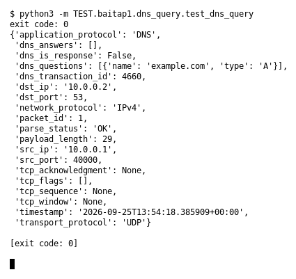

# DNS Query (Bài 1)

Chạy (từ thư mục gốc repo): `python3 -m TEST.baitap1.dns_query.test_dns_query`

## Test gì

Test case **DNS Query** ở mục 9 của đề. Yêu cầu của đề: *Parse domain và query type*.
Test đọc `input/dns_query.pcap`, chạy `capture.py --pcap` thật rồi in event (cũng được lưu ở `output/dns_query.jsonl`).

## Input và output mong đợi

- **Input:** 1 packet DNS query `example.com` kiểu A.
- **Output mong đợi:**

| Field | Mong đợi |
|---|---|
| `application_protocol` | `DNS` |
| `dns_is_response` | `False` |
| `dns_questions.0.name` | `example.com` |
| `dns_questions.0.type` | `A` |

## Kết quả chạy

Ngày chạy: 2026-10-13.

| Field | Output thật | Khớp |
|---|---|---|
| `application_protocol` | `DNS` | ✓ |
| `dns_is_response` | `False` | ✓ |
| `dns_questions.0.name` | `example.com` | ✓ |
| `dns_questions.0.type` | `A` | ✓ |

**Kết luận:** 4/4 field đúng mong đợi, exit code 0 → **ĐẠT**.
