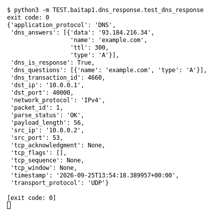

# DNS Response (Bài 1)

Chạy (từ thư mục gốc repo): `python3 -m TEST.baitap1.dns_response.test_dns_response`

## Test gì

Test case **DNS Response** ở mục 9 của đề. Yêu cầu của đề: *Parse ít nhất một answer*.
Test đọc `input/dns_response.pcap`, chạy `capture.py --pcap` thật rồi in event (cũng được lưu ở `output/dns_response.jsonl`).

## Input và output mong đợi

- **Input:** 1 packet DNS response có 1 answer.
- **Output mong đợi:**

| Field | Mong đợi |
|---|---|
| `dns_is_response` | `True` |
| `dns_answers.0.name` | `example.com` |
| `dns_answers.0.type` | `A` |
| `dns_answers.0.data` | `93.184.216.34` |

## Kết quả chạy

Ngày chạy: 2026-10-13.

| Field | Output thật | Khớp |
|---|---|---|
| `dns_is_response` | `True` | ✓ |
| `dns_answers.0.name` | `example.com` | ✓ |
| `dns_answers.0.type` | `A` | ✓ |
| `dns_answers.0.data` | `93.184.216.34` | ✓ |

**Kết luận:** 4/4 field đúng mong đợi, exit code 0 → **ĐẠT**.
