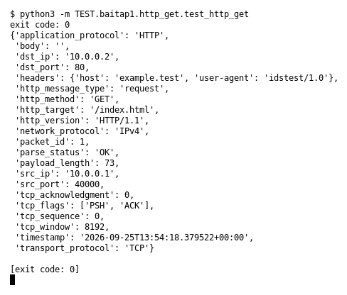

# HTTP GET (Bài 1)

Chạy (từ thư mục gốc repo): `python3 -m TEST.baitap1.http_get.test_http_get`

## Test gì

Test case **HTTP GET** ở mục 9 của đề. Yêu cầu của đề: *Parse HTTP request*.
Test đọc `input/http_get.pcap`, chạy `capture.py --pcap` thật rồi in event (cũng được lưu ở `output/http_get.jsonl`).

## Input và output mong đợi

- **Input:** 1 packet `GET /index.html HTTP/1.1`.
- **Output mong đợi:**

| Field | Mong đợi |
|---|---|
| `application_protocol` | `HTTP` |
| `http_method` | `GET` |
| `http_target` | `/index.html` |
| `http_version` | `HTTP/1.1` |
| `headers.host` | `example.test` |

## Kết quả chạy

Ngày chạy: 2026-10-13.

| Field | Output thật | Khớp |
|---|---|---|
| `application_protocol` | `HTTP` | ✓ |
| `http_method` | `GET` | ✓ |
| `http_target` | `/index.html` | ✓ |
| `http_version` | `HTTP/1.1` | ✓ |
| `headers.host` | `example.test` | ✓ |

**Kết luận:** 5/5 field đúng mong đợi, exit code 0 → **ĐẠT**.
