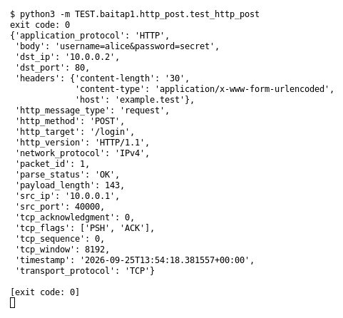

# HTTP POST (Bài 1)

Chạy (từ thư mục gốc repo): `python3 -m TEST.baitap1.http_post.test_http_post`

## Test gì

Test case **HTTP POST** ở mục 9 của đề. Yêu cầu của đề: *Parse HTTP request có body*.
Test đọc `input/http_post.pcap`, chạy `capture.py --pcap` thật rồi in event (cũng được lưu ở `output/http_post.jsonl`).

## Input và output mong đợi

- **Input:** 1 packet `POST /login` có body.
- **Output mong đợi:**

| Field | Mong đợi |
|---|---|
| `http_method` | `POST` |
| `http_target` | `/login` |
| `body` | `username=alice&password=secret` |
| `headers.content-length` | `30` |

## Kết quả chạy

Ngày chạy: 2026-10-13.

| Field | Output thật | Khớp |
|---|---|---|
| `http_method` | `POST` | ✓ |
| `http_target` | `/login` | ✓ |
| `body` | `username=alice&password=secret` | ✓ |
| `headers.content-length` | `30` | ✓ |

**Kết luận:** 4/4 field đúng mong đợi, exit code 0 → **ĐẠT**.
