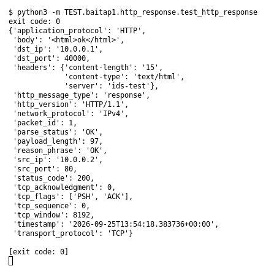

# HTTP response (Bài 1)

Chạy (từ thư mục gốc repo): `python3 -m TEST.baitap1.http_response.test_http_response`

## Test gì

Test case **HTTP response** ở mục 9 của đề. Yêu cầu của đề: *Parse status code và header*.
Test đọc `input/http_response.pcap`, chạy `capture.py --pcap` thật rồi in event (cũng được lưu ở `output/http_response.jsonl`).

## Input và output mong đợi

- **Input:** 1 packet `HTTP/1.1 200 OK`.
- **Output mong đợi:**

| Field | Mong đợi |
|---|---|
| `http_message_type` | `response` |
| `status_code` | `200` |
| `reason_phrase` | `OK` |
| `headers.server` | `ids-test` |

## Kết quả chạy

Ngày chạy: 2026-10-13.

| Field | Output thật | Khớp |
|---|---|---|
| `http_message_type` | `response` | ✓ |
| `status_code` | `200` | ✓ |
| `reason_phrase` | `OK` | ✓ |
| `headers.server` | `ids-test` | ✓ |

**Kết luận:** 4/4 field đúng mong đợi, exit code 0 → **ĐẠT**.
