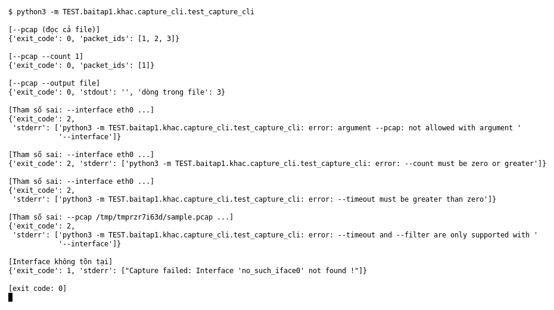

# Capture CLI (Bài 1)

Chạy (từ thư mục gốc repo): `python3 -m TEST.baitap1.khac.capture_cli.test_capture_cli`

## Test gì

Chạy `capture.main()` với các tham số thật (đọc PCAP, giới hạn `--count`, ghi `--output`,
tham số sai, interface không tồn tại) và in exit code cùng thông báo ra.

## Input và output mong đợi

| Case | Input | Output mong đợi |
|---|---|---|
| `--pcap` | PCAP 3 packet | exit 0, 3 event (`packet_id` 1, 2, 3) |
| `--pcap --count 1` | như trên | exit 0, chỉ 1 event |
| `--pcap --output file` | như trên | exit 0, stdout trống, file có 3 dòng |
| Tham số sai (4 case) | `--pcap` cùng `--interface`, `--count -1`, `--timeout 0`, `--filter` với `--pcap` | exit 2, thông báo lỗi rõ ràng |
| Interface không tồn tại | `--interface no_such_iface0` | exit 1, `Capture failed: …` |

## Kết quả chạy

Ngày chạy: 2026-10-13.

| Case | Output thật | Khớp |
|---|---|---|
| `--pcap` | exit 0, `[1, 2, 3]` | ✓ |
| `--count 1` | exit 0, `[1]` | ✓ |
| `--output file` | exit 0, stdout `''`, 3 dòng | ✓ |
| Tham số sai (4 case) | exit 2, lỗi `not allowed with`, `must be zero or greater`, `must be greater than zero`, `only supported with --interface` | ✓ |
| Interface không tồn tại | exit 1, `Capture failed: Interface 'no_such_iface0' not found !` | ✓ |

**Kết luận:** 8/8 case đúng mong đợi → **ĐẠT**.
Lưu ý: bắt gói thật từ interface hợp lệ cần quyền root nên chưa chạy ở đây. Chỉ kiểm tra được trường hợp interface không tồn tại.
