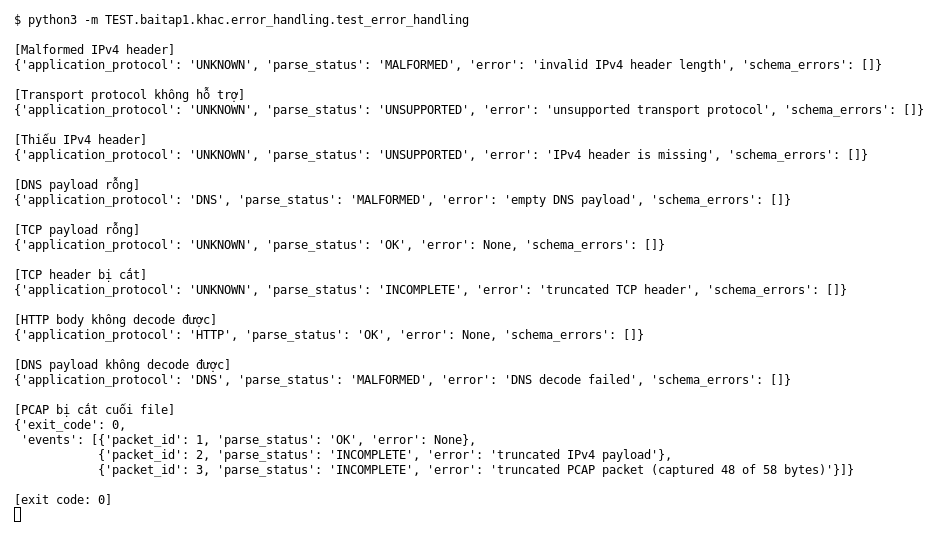

# Error handling (Bài 1)

Chạy (từ thư mục gốc repo): `python3 -m TEST.baitap1.khac.error_handling.test_error_handling`

## Test gì

Mục 7 của đề: gặp packet malformed, unsupported protocol, thiếu header, payload rỗng,
PCAP bị cắt hoặc payload không decode được thì chương trình **không được dừng**.
Mỗi case in `parse_status`, `error` và kết quả `validate_event()`.

## Input và output mong đợi

| Case | Output mong đợi |
|---|---|
| Malformed IPv4 header | `MALFORMED` |
| Transport protocol không hỗ trợ | `UNSUPPORTED` |
| Thiếu IPv4 header | `UNSUPPORTED` |
| DNS payload rỗng | `MALFORMED`, báo `empty DNS payload` |
| TCP payload rỗng | `OK` (không phải lỗi) |
| TCP header bị cắt | `INCOMPLETE`, báo `truncated TCP header` |
| HTTP body byte lỗi | `OK`, vẫn parse được |
| DNS payload không decode được | `MALFORMED`, báo `DNS decode failed` |
| PCAP bị cắt cuối file | exit 0, packet đọc được vẫn có event, có event `INCOMPLETE` |

Mọi event lỗi vẫn phải hợp lệ theo schema (`schema_errors = []`).

## Kết quả chạy

Ngày chạy: 2026-10-13.

| Case | Output thật | Khớp |
|---|---|---|
| Malformed IPv4 | `MALFORMED`, `invalid IPv4 header length` | ✓ |
| Transport không hỗ trợ | `UNSUPPORTED`, `unsupported transport protocol` | ✓ |
| Thiếu IPv4 | `UNSUPPORTED`, `IPv4 header is missing` | ✓ |
| DNS rỗng | `MALFORMED`, `empty DNS payload` | ✓ |
| TCP rỗng | `OK` | ✓ |
| TCP header cắt | `INCOMPLETE`, `truncated TCP header` | ✓ |
| HTTP body lỗi | HTTP, `OK` | ✓ |
| DNS không decode | `MALFORMED`, `DNS decode failed` | ✓ |
| PCAP bị cắt | exit 0; packet 1 `OK`; packet 2, 3 `INCOMPLETE` | ✓ |

Cả 8 event đều có `schema_errors = []`.

**Kết luận:** 9/9 case đúng mong đợi, không có crash → **ĐẠT**.
