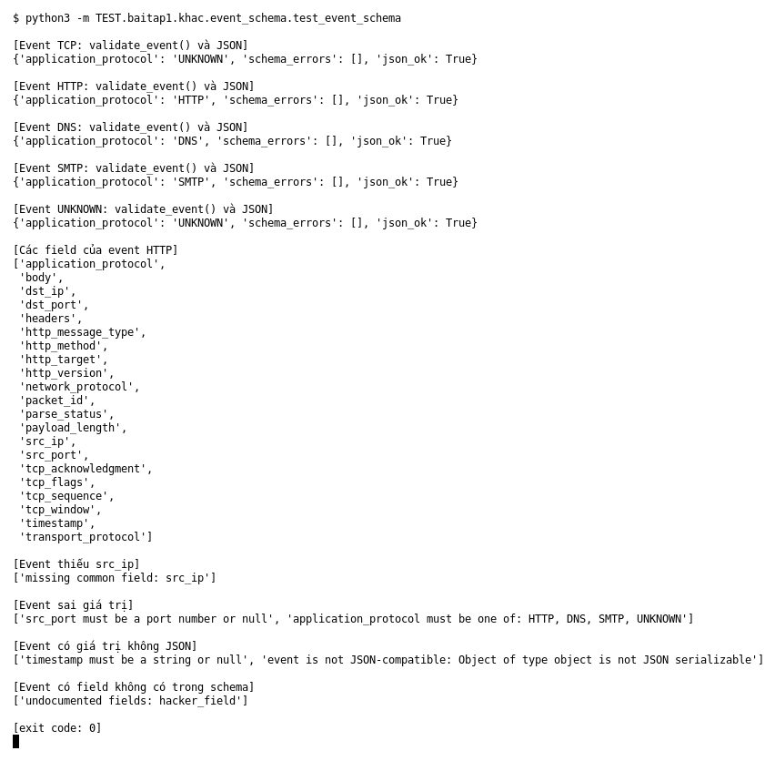

# Event schema (Bài 1)

Chạy (từ thư mục gốc repo): `python3 -m TEST.baitap1.khac.event_schema.test_event_schema`

## Test gì

Mục 6 của đề: output phải có cấu trúc thống nhất. Test in event của 5 loại packet cùng kết quả
`validate_event()`, rồi cố ý làm hỏng event để xem `validate_event()` báo lỗi gì.

## Input và output mong đợi

| Case | Input | Output mong đợi |
|---|---|---|
| Event TCP, HTTP, DNS, SMTP, UNKNOWN | 5 packet mẫu | `schema_errors = []`, serialize JSON được |
| Field của event HTTP | event HTTP | có field chung và field HTTP (`http_method`, `http_target`, `headers`, `body`…) |
| Event thiếu `src_ip` | xóa `src_ip` | báo thiếu common field `src_ip` |
| Event sai giá trị | `application_protocol = BAD`, `src_port = 70000` | báo cả hai field sai |
| Giá trị không JSON | `timestamp = object()` | báo không JSON-compatible |
| Field lạ | thêm `hacker_field` | báo `undocumented fields` |

## Kết quả chạy

Ngày chạy: 2026-10-13.

| Case | Output thật | Khớp |
|---|---|---|
| 5 loại event | cả 5 `schema_errors = []`, `json_ok = True` | ✓ |
| Field event HTTP | có `http_*`, `headers`, `body` cùng field chung | ✓ |
| Thiếu `src_ip` | `missing common field: src_ip` | ✓ |
| Sai giá trị | `src_port must be a port number or null`; `application_protocol must be one of: HTTP, DNS, SMTP, UNKNOWN` | ✓ |
| Không JSON | `event is not JSON-compatible` | ✓ |
| Field lạ | `undocumented fields: hacker_field` | ✓ |

**Kết luận:** 6/6 nhóm case đúng mong đợi → **ĐẠT**.
