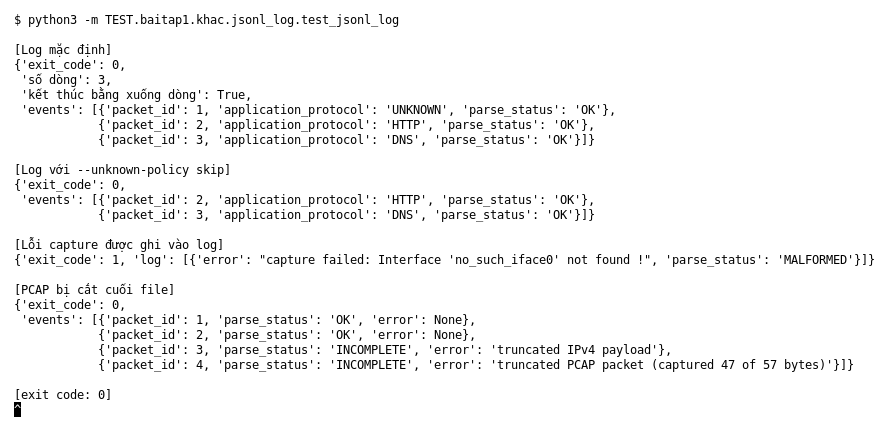

# JSON Lines log (Bài 1)

Chạy (từ thư mục gốc repo): `python3 -m TEST.baitap1.khac.jsonl_log.test_jsonl_log`

## Test gì

Chạy `capture.py --output` và đọc lại file log để xem mỗi packet là một dòng JSON,
đúng thứ tự capture, và lỗi cũng được ghi vào log.

## Input và output mong đợi

| Case | Input | Output mong đợi |
|---|---|---|
| Log mặc định | PCAP 3 packet: unknown, HTTP, DNS | 3 dòng, `packet_id` 1, 2, 3, đúng thứ tự, kết thúc bằng xuống dòng |
| `--unknown-policy skip` | như trên | 2 dòng: HTTP (id 2), DNS (id 3) |
| Lỗi capture | `--interface no_such_iface0` | exit 1, log có 1 dòng chứa `capture failed` |
| PCAP bị cắt cuối file | cắt 10 byte cuối | exit 0, packet đọc được vẫn có event, có event báo `truncated` |

## Kết quả chạy

Ngày chạy: 2026-10-13.

| Case | Output thật | Khớp |
|---|---|---|
| Log mặc định | 3 dòng: UNKNOWN, HTTP, DNS; kết thúc bằng xuống dòng | ✓ |
| `skip` | 2 dòng: HTTP (2), DNS (3) | ✓ |
| Lỗi capture | exit 1, `capture failed: Interface 'no_such_iface0' not found !` | ✓ |
| PCAP bị cắt | exit 0; packet 1, 2 `OK`; packet 3 `INCOMPLETE` (`truncated IPv4 payload`); packet 4 `INCOMPLETE` (`truncated PCAP packet`) | ✓ |

**Kết luận:** 4/4 case đúng mong đợi → **ĐẠT**.
