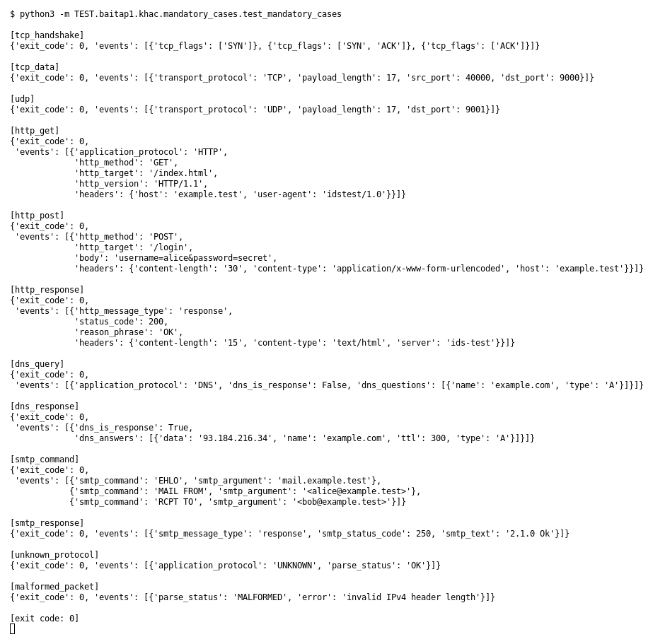

# Mandatory cases (Bài 1)

Chạy (từ thư mục gốc repo): `python3 -m TEST.baitap1.khac.mandatory_cases.test_mandatory_cases`

## Test gì

12 test case bắt buộc ở mục 9 của đề. Mỗi case dựng một PCAP nhỏ (trong `mandatory_cases.py`),
chạy `capture.py --pcap` thật rồi in ra các field của event để so với yêu cầu của đề.

## Input và output mong đợi

| Case | Input | Output mong đợi (theo đề) |
|---|---|---|
| tcp_handshake | 3 packet SYN, SYN/ACK, ACK | nhận ra đúng cờ của từng packet |
| tcp_data | TCP có payload `hello tcp payload` | `payload_length` = 17 |
| udp | UDP có payload | transport = UDP, `payload_length` = 17 |
| http_get | `GET /index.html` | method GET, target `/index.html`, version, header host |
| http_post | `POST /login` có body | method POST, body `username=alice&password=secret` |
| http_response | `HTTP/1.1 200 OK` | status 200, có header |
| dns_query | query `example.com` kiểu A | domain `example.com`, type A |
| dns_response | response có 1 answer | ít nhất 1 answer (`93.184.216.34`) |
| smtp_command | EHLO, MAIL FROM, RCPT TO | 3 event với đúng command và argument |
| smtp_response | `250 2.1.0 Ok` | status code 250 |
| unknown_protocol | UDP payload bất kỳ | không crash, `UNKNOWN` |
| malformed_packet | IPv4 header sai độ dài | không crash, `MALFORMED` |

## Kết quả chạy

Ngày chạy: 2026-10-13. Exit code `0`.

| Case | Output thật | Khớp |
|---|---|---|
| tcp_handshake | `[SYN]`, `[SYN, ACK]`, `[ACK]` | ✓ |
| tcp_data | TCP, payload_length 17 | ✓ |
| udp | UDP, payload_length 17 | ✓ |
| http_get | HTTP, GET, `/index.html`, `HTTP/1.1`, host `example.test` | ✓ |
| http_post | POST, `/login`, body `username=alice&password=secret` | ✓ |
| http_response | status 200, `OK`, có header | ✓ |
| dns_query | DNS, `example.com`, A | ✓ |
| dns_response | 1 answer `93.184.216.34` (ttl 300) | ✓ |
| smtp_command | `EHLO`, `MAIL FROM`, `RCPT TO` kèm argument | ✓ |
| smtp_response | 250, `2.1.0 Ok` | ✓ |
| unknown_protocol | `UNKNOWN`, parse_status `OK` | ✓ |
| malformed_packet | `MALFORMED`, `invalid IPv4 header length` | ✓ |

**Kết luận:** 12/12 case đúng mong đợi → **ĐẠT**.
PCAP và JSONL của từng case nằm trong folder của case đó (`TEST/baitap1/<tên case>/input` và `output`), được sinh bằng `make_test_pcaps.py`.
