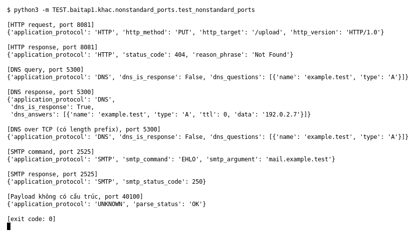

# Non-standard ports (Bài 1)

Chạy (từ thư mục gốc repo): `python3 -m TEST.baitap1.khac.nonstandard_ports.test_nonstandard_ports`

## Test gì

Mục 5 của đề (điểm thưởng): nhận diện application protocol theo nội dung payload,
không chỉ theo port. Test đưa HTTP, DNS, SMTP lên port lạ và in protocol nhận ra được.

## Input và output mong đợi

| Case | Input | Output mong đợi |
|---|---|---|
| HTTP request, port 8081 | `PUT /upload HTTP/1.0` | HTTP, PUT, `/upload`, `HTTP/1.0` |
| HTTP response, port 8081 | `404 Not Found` | HTTP, status 404, `Not Found` |
| DNS query / response, port 5300 | `example.test` kiểu A | DNS, đúng domain; response có answer |
| DNS over TCP, port 5300 | có 2 byte độ dài ở đầu | DNS, domain `example.test` |
| SMTP command / response, port 2525 | `EHLO …`, `250 OK` | SMTP, `EHLO`; status 250 |
| Payload không có cấu trúc, port 40100 | `unstructured-payload` | `UNKNOWN` (không đoán bừa) |

## Kết quả chạy

Ngày chạy: 2026-10-13.

| Case | Output thật | Khớp |
|---|---|---|
| HTTP request | HTTP, `PUT`, `/upload`, `HTTP/1.0` | ✓ |
| HTTP response | HTTP, 404, `Not Found` | ✓ |
| DNS query / response | DNS, `example.test`; answer `192.0.2.7` | ✓ |
| DNS over TCP | DNS, `example.test` | ✓ |
| SMTP command / response | SMTP, `EHLO` `mail.example.test`; SMTP 250 | ✓ |
| Payload không cấu trúc | `UNKNOWN`, parse_status `OK` | ✓ |

**Kết luận:** 8/8 case đúng mong đợi → **ĐẠT**.
