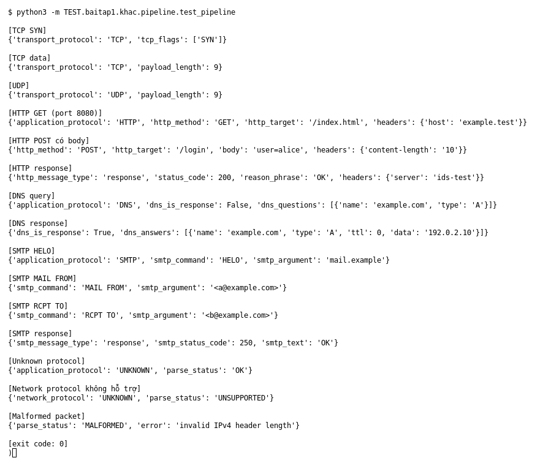

# Pipeline parser (Bài 1)

Chạy (từ thư mục gốc repo): `python3 -m TEST.baitap1.khac.pipeline.test_pipeline`

## Test gì

Đưa từng packet (dựng bằng Scapy) vào `parse_packet()` và in event để xem parser nhận ra
TCP, UDP, HTTP, DNS, SMTP, gói unknown, gói không hỗ trợ và gói malformed đúng không.

## Input và output mong đợi

| Case | Input | Output mong đợi |
|---|---|---|
| TCP SYN | TCP cờ S | TCP, `tcp_flags = [SYN]` |
| TCP data, UDP | payload 9 byte | đúng transport, `payload_length` = 9 |
| HTTP GET (port 8080) | `GET /index.html` | HTTP, GET, `/index.html`, host (nhận ra trên port lạ) |
| HTTP POST | có body `user=alice` | POST, `/login`, body, content-length |
| HTTP response | `200 OK` | status 200, `OK`, header server |
| DNS query / response | `example.com` kiểu A | domain, type; response có 1 answer |
| SMTP HELO, MAIL FROM, RCPT TO | 3 lệnh | đúng command và argument |
| SMTP response | `250 OK` | status 250 |
| Unknown protocol | UDP payload bất kỳ | `UNKNOWN`, không crash |
| Network không hỗ trợ | không có IPv4 | `UNSUPPORTED`, không crash |
| Malformed packet | IPv4 header sai | `MALFORMED`, không crash |

## Kết quả chạy

Ngày chạy: 2026-10-13.

| Nhóm case | Output thật | Khớp |
|---|---|---|
| TCP SYN, TCP data, UDP | TCP `[SYN]`; TCP 9 byte; UDP 9 byte | ✓ |
| HTTP GET / POST / response | GET `/index.html` host `example.test`; POST body `user=alice`; 200 `OK` | ✓ |
| DNS query / response | `example.com` A; answer `192.0.2.10` | ✓ |
| SMTP (4 case) | `HELO`, `MAIL FROM`, `RCPT TO`, status 250 | ✓ |
| Unknown / không hỗ trợ / malformed | `UNKNOWN` OK; `UNSUPPORTED`; `MALFORMED` (`invalid IPv4 header length`) | ✓ |

**Kết luận:** 15/15 case đúng mong đợi → **ĐẠT**.
