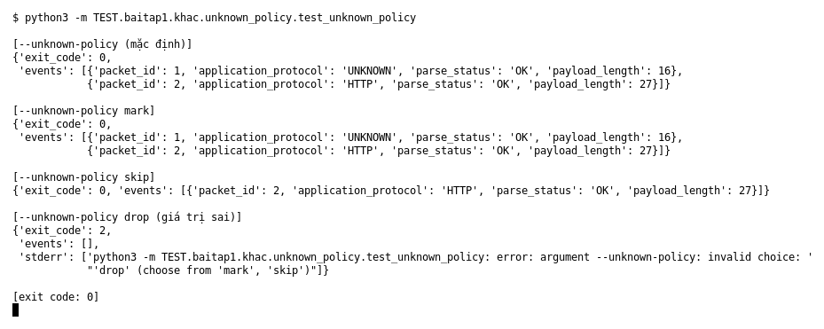

# Unknown policy (Bài 1)

Chạy (từ thư mục gốc repo): `python3 -m TEST.baitap1.khac.unknown_policy.test_unknown_policy`

## Test gì

Mục 3 của đề: packet không thuộc protocol hỗ trợ có thể được đánh dấu `UNKNOWN` hoặc bỏ qua
theo cấu hình. Test chạy `capture.py` với `--unknown-policy` mặc định, `mark`, `skip` và giá trị sai.

## Input và output mong đợi

Input: PCAP 2 packet, packet 1 là unknown (UDP 16 byte), packet 2 là HTTP.

| Case | Output mong đợi |
|---|---|
| mặc định và `mark` | exit 0, 2 event: unknown (id 1, `UNKNOWN`, `payload_length` 16) và HTTP (id 2) |
| `skip` | exit 0, chỉ còn HTTP (id 2) |
| `drop` (giá trị sai) | exit 2, không có event, báo `invalid choice` |

## Kết quả chạy

Ngày chạy: 2026-10-13.

| Case | Output thật | Khớp |
|---|---|---|
| mặc định | 2 event: `UNKNOWN` (16 byte), `HTTP` | ✓ |
| `mark` | giống mặc định | ✓ |
| `skip` | 1 event: `HTTP` (id 2) | ✓ |
| `drop` | exit 2, `invalid choice: 'drop' (choose from 'mark', 'skip')` | ✓ |

**Kết luận:** 4/4 case đúng mong đợi → **ĐẠT**.
