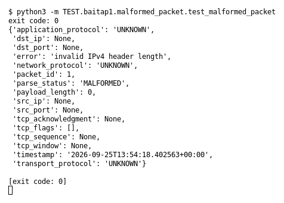

# Malformed packet (Bài 1)

Chạy (từ thư mục gốc repo): `python3 -m TEST.baitap1.malformed_packet.test_malformed_packet`

## Test gì

Test case **Malformed packet** ở mục 9 của đề. Yêu cầu của đề: *Không crash*.
Test đọc `input/malformed_packet.pcap`, chạy `capture.py --pcap` thật rồi in event (cũng được lưu ở `output/malformed_packet.jsonl`).

## Input và output mong đợi

- **Input:** 1 packet có IPv4 header sai độ dài.
- **Output mong đợi:**

| Field | Mong đợi |
|---|---|
| `parse_status` | `MALFORMED` |
| `error` | `invalid IPv4 header length` |

## Kết quả chạy

Ngày chạy: 2026-10-13.

| Field | Output thật | Khớp |
|---|---|---|
| `parse_status` | `MALFORMED` | ✓ |
| `error` | `invalid IPv4 header length` | ✓ |

**Kết luận:** 2/2 field đúng mong đợi, exit code 0 → **ĐẠT**.
