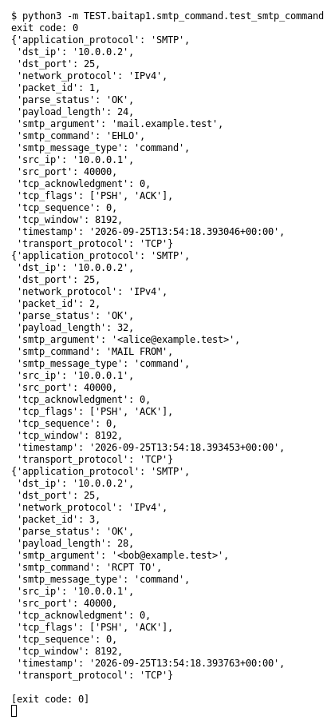

# SMTP command (Bài 1)

Chạy (từ thư mục gốc repo): `python3 -m TEST.baitap1.smtp_command.test_smtp_command`

## Test gì

Test case **SMTP command** ở mục 9 của đề. Yêu cầu của đề: *Parse HELO/EHLO, MAIL FROM hoặc RCPT TO*.
Test đọc `input/smtp_command.pcap`, chạy `capture.py --pcap` thật rồi in event (cũng được lưu ở `output/smtp_command.jsonl`).

## Input và output mong đợi

- **Input:** 3 packet: EHLO, MAIL FROM, RCPT TO.
- **Output mong đợi:**

| Field | Mong đợi |
|---|---|
| event 1: `smtp_command` | `EHLO` |
| event 1: `smtp_argument` | `mail.example.test` |
| event 2: `smtp_command` | `MAIL FROM` |
| event 2: `smtp_argument` | `<alice@example.test>` |
| event 3: `smtp_command` | `RCPT TO` |
| event 3: `smtp_argument` | `<bob@example.test>` |

## Kết quả chạy

Ngày chạy: 2026-10-13.

| Field | Output thật | Khớp |
|---|---|---|
| event 1: `smtp_command` | `EHLO` | ✓ |
| event 1: `smtp_argument` | `mail.example.test` | ✓ |
| event 2: `smtp_command` | `MAIL FROM` | ✓ |
| event 2: `smtp_argument` | `<alice@example.test>` | ✓ |
| event 3: `smtp_command` | `RCPT TO` | ✓ |
| event 3: `smtp_argument` | `<bob@example.test>` | ✓ |

**Kết luận:** 6/6 field đúng mong đợi, exit code 0 → **ĐẠT**.
