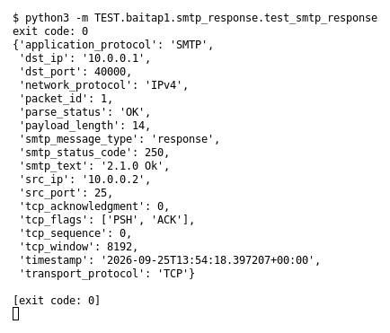

# SMTP response (Bài 1)

Chạy (từ thư mục gốc repo): `python3 -m TEST.baitap1.smtp_response.test_smtp_response`

## Test gì

Test case **SMTP response** ở mục 9 của đề. Yêu cầu của đề: *Parse SMTP status code*.
Test đọc `input/smtp_response.pcap`, chạy `capture.py --pcap` thật rồi in event (cũng được lưu ở `output/smtp_response.jsonl`).

## Input và output mong đợi

- **Input:** 1 packet `250 2.1.0 Ok`.
- **Output mong đợi:**

| Field | Mong đợi |
|---|---|
| `smtp_message_type` | `response` |
| `smtp_status_code` | `250` |
| `smtp_text` | `2.1.0 Ok` |

## Kết quả chạy

Ngày chạy: 2026-10-13.

| Field | Output thật | Khớp |
|---|---|---|
| `smtp_message_type` | `response` | ✓ |
| `smtp_status_code` | `250` | ✓ |
| `smtp_text` | `2.1.0 Ok` | ✓ |

**Kết luận:** 3/3 field đúng mong đợi, exit code 0 → **ĐẠT**.
