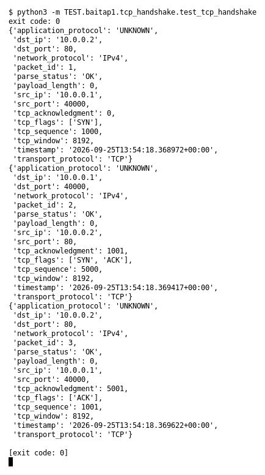

# TCP handshake (Bài 1)

Chạy (từ thư mục gốc repo): `python3 -m TEST.baitap1.tcp_handshake.test_tcp_handshake`

## Test gì

Test case **TCP handshake** ở mục 9 của đề. Yêu cầu của đề: *Nhận diện SYN, SYN/ACK, ACK*.
Test đọc `input/tcp_handshake.pcap`, chạy `capture.py --pcap` thật rồi in event (cũng được lưu ở `output/tcp_handshake.jsonl`).

## Input và output mong đợi

- **Input:** 3 packet TCP: SYN, SYN/ACK, ACK.
- **Output mong đợi:**

| Field | Mong đợi |
|---|---|
| event 1: `tcp_flags` | `['SYN']` |
| event 2: `tcp_flags` | `['SYN', 'ACK']` |
| event 3: `tcp_flags` | `['ACK']` |

## Kết quả chạy

Ngày chạy: 2026-10-13.

| Field | Output thật | Khớp |
|---|---|---|
| event 1: `tcp_flags` | `['SYN']` | ✓ |
| event 2: `tcp_flags` | `['SYN', 'ACK']` | ✓ |
| event 3: `tcp_flags` | `['ACK']` | ✓ |

**Kết luận:** 3/3 field đúng mong đợi, exit code 0 → **ĐẠT**.
