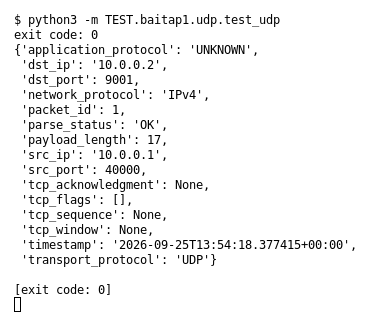

# UDP (Bài 1)

Chạy (từ thư mục gốc repo): `python3 -m TEST.baitap1.udp.test_udp`

## Test gì

Test case **UDP** ở mục 9 của đề. Yêu cầu của đề: *Parse UDP packet*.
Test đọc `input/udp.pcap`, chạy `capture.py --pcap` thật rồi in event (cũng được lưu ở `output/udp.jsonl`).

## Input và output mong đợi

- **Input:** 1 packet UDP có payload `hello udp payload` (17 byte).
- **Output mong đợi:**

| Field | Mong đợi |
|---|---|
| `transport_protocol` | `UDP` |
| `payload_length` | `17` |
| `dst_port` | `9001` |

## Kết quả chạy

Ngày chạy: 2026-10-13.

| Field | Output thật | Khớp |
|---|---|---|
| `transport_protocol` | `UDP` | ✓ |
| `payload_length` | `17` | ✓ |
| `dst_port` | `9001` | ✓ |

**Kết luận:** 3/3 field đúng mong đợi, exit code 0 → **ĐẠT**.
