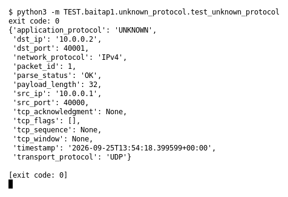

# Unknown protocol (Bài 1)

Chạy (từ thư mục gốc repo): `python3 -m TEST.baitap1.unknown_protocol.test_unknown_protocol`

## Test gì

Test case **Unknown protocol** ở mục 9 của đề. Yêu cầu của đề: *Không crash*.
Test đọc `input/unknown_protocol.pcap`, chạy `capture.py --pcap` thật rồi in event (cũng được lưu ở `output/unknown_protocol.jsonl`).

## Input và output mong đợi

- **Input:** 1 packet UDP có payload không thuộc protocol nào được hỗ trợ.
- **Output mong đợi:**

| Field | Mong đợi |
|---|---|
| `application_protocol` | `UNKNOWN` |
| `parse_status` | `OK` |

## Kết quả chạy

Ngày chạy: 2026-10-13.

| Field | Output thật | Khớp |
|---|---|---|
| `application_protocol` | `UNKNOWN` | ✓ |
| `parse_status` | `OK` | ✓ |

**Kết luận:** 2/2 field đúng mong đợi, exit code 0 → **ĐẠT**.
