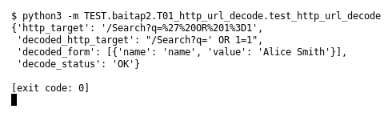

# T01 — HTTP URL decode (Bài 2)

Chạy (từ thư mục gốc repo): `python3 -m TEST.baitap2.T01_http_url_decode.test_http_url_decode`

## Test gì

Test case **T01 HTTP URL decode** ở mục 6 của đề.
Input/Scenario của đề: *URI chứa percent-encoding*. Kết quả mong đợi của đề: *decoded URI đúng; raw URI còn nguyên*.

## Input và output mong đợi

Input nằm ngay trong file `test_http_url_decode.py` (event dựng sẵn). Output mong đợi:

| Field | Mong đợi |
|---|---|
| `decoded_http_target` | `/Search?q=' OR 1=1` |
| `http_target` | `/Search?q=%27%20OR%201%3D1` |
| `decoded_form` | `[{'name': 'name', 'value': 'Alice Smith'}]` |
| `decode_status` | `OK` |

## Kết quả chạy

Ngày chạy: 2026-10-13.

| Field | Output thật | Khớp |
|---|---|---|
| `decoded_http_target` | `/Search?q=' OR 1=1` | ✓ |
| `http_target` | `/Search?q=%27%20OR%201%3D1` | ✓ |
| `decoded_form` | `[{'name': 'name', 'value': 'Alice Smith'}]` | ✓ |
| `decode_status` | `OK` | ✓ |

**Kết luận:** 4/4 field đúng mong đợi, exit code 0 → **ĐẠT**.
