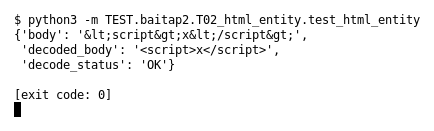

# T02 — HTML entity (Bài 2)

Chạy (từ thư mục gốc repo): `python3 -m TEST.baitap2.T02_html_entity.test_html_entity`

## Test gì

Test case **T02 HTML entity** ở mục 6 của đề.
Input/Scenario của đề: *`&lt;...&gt;` trong text HTTP*. Kết quả mong đợi của đề: *decoded text đúng, không crash*.

## Input và output mong đợi

Input nằm ngay trong file `test_html_entity.py` (event dựng sẵn). Output mong đợi:

| Field | Mong đợi |
|---|---|
| `decoded_body` | `` |
| `body` | `&lt;script&gt;x&lt;/script&gt;` |
| `decode_status` | `OK` |

## Kết quả chạy

Ngày chạy: 2026-10-13.

| Field | Output thật | Khớp |
|---|---|---|
| `decoded_body` | `` | ✓ |
| `body` | `&lt;script&gt;x&lt;/script&gt;` | ✓ |
| `decode_status` | `OK` | ✓ |

**Kết luận:** 3/3 field đúng mong đợi, exit code 0 → **ĐẠT**.
