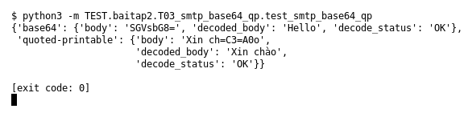

# T03 — SMTP Base64/QP (Bài 2)

Chạy (từ thư mục gốc repo): `python3 -m TEST.baitap2.T03_smtp_base64_qp.test_smtp_base64_qp`

## Test gì

Test case **T03 SMTP Base64/QP** ở mục 6 của đề.
Input/Scenario của đề: *MIME body có encoding phù hợp (Base64 và Quoted-Printable)*. Kết quả mong đợi của đề: *decoded body đúng + decode_status*.

## Input và output mong đợi

Input nằm ngay trong file `test_smtp_base64_qp.py` (event dựng sẵn). Output mong đợi:

| Field | Mong đợi |
|---|---|
| `base64.decoded_body` | `Hello` |
| `base64.decode_status` | `OK` |
| `quoted-printable.decoded_body` | `Xin chào` |
| `quoted-printable.decode_status` | `OK` |

## Kết quả chạy

Ngày chạy: 2026-10-13.

| Field | Output thật | Khớp |
|---|---|---|
| `base64.decoded_body` | `Hello` | ✓ |
| `base64.decode_status` | `OK` | ✓ |
| `quoted-printable.decoded_body` | `Xin chào` | ✓ |
| `quoted-printable.decode_status` | `OK` | ✓ |

**Kết luận:** 4/4 field đúng mong đợi, exit code 0 → **ĐẠT**.
