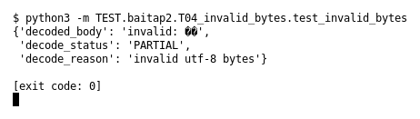

# T04 — Invalid bytes (Bài 2)

Chạy (từ thư mục gốc repo): `python3 -m TEST.baitap2.T04_invalid_bytes.test_invalid_bytes`

## Test gì

Test case **T04 Invalid bytes** ở mục 6 của đề.
Input/Scenario của đề: *Payload không phải UTF-8 hợp lệ*. Kết quả mong đợi của đề: *đánh dấu lỗi/partial; chương trình tiếp tục*.

## Input và output mong đợi

Input nằm ngay trong file `test_invalid_bytes.py` (event dựng sẵn). Output mong đợi:

| Field | Mong đợi |
|---|---|
| `decode_status` | `PARTIAL` |
| `decode_reason` | chứa `invalid utf-8` |

## Kết quả chạy

Ngày chạy: 2026-10-13.

| Field | Output thật | Khớp |
|---|---|---|
| `decode_status` | `PARTIAL` | ✓ |
| `decode_reason` | `invalid utf-8 bytes` | ✓ |

**Kết luận:** 2/2 field đúng mong đợi, exit code 0 → **ĐẠT**.
