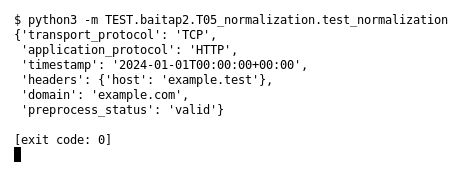

# T05 — Normalization (Bài 2)

Chạy (từ thư mục gốc repo): `python3 -m TEST.baitap2.T05_normalization.test_normalization`

## Test gì

Test case **T05 Normalization** ở mục 6 của đề.
Input/Scenario của đề: *header/protocol/domain khác kiểu chữ hoặc format*. Kết quả mong đợi của đề: *representation sau preprocess nhất quán*.

## Input và output mong đợi

Input nằm ngay trong file `test_normalization.py` (event dựng sẵn). Output mong đợi:

| Field | Mong đợi |
|---|---|
| `transport_protocol` | `TCP` |
| `application_protocol` | `HTTP` |
| `timestamp` | `2024-01-01T00:00:00+00:00` |
| `headers` | `{'host': 'example.test'}` |
| `domain` | `example.com` |
| `preprocess_status` | `valid` |

## Kết quả chạy

Ngày chạy: 2026-10-13.

| Field | Output thật | Khớp |
|---|---|---|
| `transport_protocol` | `TCP` | ✓ |
| `application_protocol` | `HTTP` | ✓ |
| `timestamp` | `2024-01-01T00:00:00+00:00` | ✓ |
| `headers` | `{'host': 'example.test'}` | ✓ |
| `domain` | `example.com` | ✓ |
| `preprocess_status` | `valid` | ✓ |

**Kết luận:** 6/6 field đúng mong đợi, exit code 0 → **ĐẠT**.
