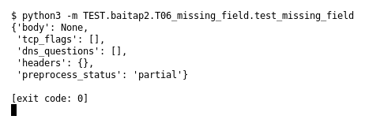

# T06 — Missing field (Bài 2)

Chạy (từ thư mục gốc repo): `python3 -m TEST.baitap2.T06_missing_field.test_missing_field`

## Test gì

Test case **T06 Missing field** ở mục 6 của đề.
Input/Scenario của đề: *event thiếu field không bắt buộc*. Kết quả mong đợi của đề: *xử lý null/[] nhất quán, không exception*.

## Input và output mong đợi

Input nằm ngay trong file `test_missing_field.py` (event dựng sẵn). Output mong đợi:

| Field | Mong đợi |
|---|---|
| `body` | `None` |
| `tcp_flags` | `[]` |
| `dns_questions` | `[]` |
| `headers` | `{}` |
| `preprocess_status` | `partial` |

## Kết quả chạy

Ngày chạy: 2026-10-13.

| Field | Output thật | Khớp |
|---|---|---|
| `body` | `None` | ✓ |
| `tcp_flags` | `[]` | ✓ |
| `dns_questions` | `[]` | ✓ |
| `headers` | `{}` | ✓ |
| `preprocess_status` | `partial` | ✓ |

**Kết luận:** 5/5 field đúng mong đợi, exit code 0 → **ĐẠT**.
