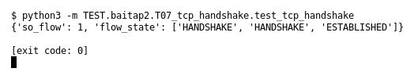

# T07 — TCP handshake (Bài 2)

Chạy (từ thư mục gốc repo): `python3 -m TEST.baitap2.T07_tcp_handshake.test_tcp_handshake`

## Test gì

Test case **T07 TCP handshake** ở mục 6 của đề.
Input/Scenario của đề: *SYN → SYN/ACK → ACK*. Kết quả mong đợi của đề: *1 flow; trạng thái ESTABLISHED*.

## Input và output mong đợi

Input nằm ngay trong file `test_tcp_handshake.py` (event dựng sẵn). Output mong đợi:

| Field | Mong đợi |
|---|---|
| `so_flow` | `1` |
| `flow_state` | `['HANDSHAKE', 'HANDSHAKE', 'ESTABLISHED']` |

## Kết quả chạy

Ngày chạy: 2026-10-13.

| Field | Output thật | Khớp |
|---|---|---|
| `so_flow` | `1` | ✓ |
| `flow_state` | `['HANDSHAKE', 'HANDSHAKE', 'ESTABLISHED']` | ✓ |

**Kết luận:** 2/2 field đúng mong đợi, exit code 0 → **ĐẠT**.
