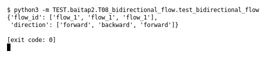

# T08 — Bidirectional flow (Bài 2)

Chạy (từ thư mục gốc repo): `python3 -m TEST.baitap2.T08_bidirectional_flow.test_bidirectional_flow`

## Test gì

Test case **T08 Bidirectional flow** ở mục 6 của đề.
Input/Scenario của đề: *packet A→B và B→A cùng 5-tuple đảo chiều*. Kết quả mong đợi của đề: *cùng flow_id; đúng direction*.

## Input và output mong đợi

Input nằm ngay trong file `test_bidirectional_flow.py` (event dựng sẵn). Output mong đợi:

| Field | Mong đợi |
|---|---|
| `flow_id` | giống nhau ở cả 3 packet |
| `direction` | `['forward', 'backward', 'forward']` |

## Kết quả chạy

Ngày chạy: 2026-10-13.

| Field | Output thật | Khớp |
|---|---|---|
| `flow_id` | `['flow_1', 'flow_1', 'flow_1']` | ✓ |
| `direction` | `['forward', 'backward', 'forward']` | ✓ |

**Kết luận:** 2/2 field đúng mong đợi, exit code 0 → **ĐẠT**.
