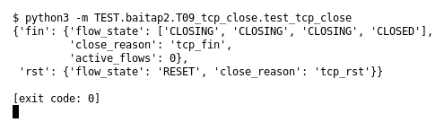

# T09 — TCP close (Bài 2)

Chạy (từ thư mục gốc repo): `python3 -m TEST.baitap2.T09_tcp_close.test_tcp_close`

## Test gì

Test case **T09 TCP close** ở mục 6 của đề.
Input/Scenario của đề: *FIN/ACK hoặc RST*. Kết quả mong đợi của đề: *flow chuyển CLOSED/RESET phù hợp*.

## Input và output mong đợi

Input nằm ngay trong file `test_tcp_close.py` (event dựng sẵn). Output mong đợi:

| Field | Mong đợi |
|---|---|
| `fin.flow_state` | `['CLOSING', 'CLOSING', 'CLOSING', 'CLOSED']` |
| `fin.close_reason` | `tcp_fin` |
| `fin.active_flows` | `0` |
| `rst.flow_state` | `RESET` |
| `rst.close_reason` | `tcp_rst` |

## Kết quả chạy

Ngày chạy: 2026-10-13.

| Field | Output thật | Khớp |
|---|---|---|
| `fin.flow_state` | `['CLOSING', 'CLOSING', 'CLOSING', 'CLOSED']` | ✓ |
| `fin.close_reason` | `tcp_fin` | ✓ |
| `fin.active_flows` | `0` | ✓ |
| `rst.flow_state` | `RESET` | ✓ |
| `rst.close_reason` | `tcp_rst` | ✓ |

**Kết luận:** 5/5 field đúng mong đợi, exit code 0 → **ĐẠT**.
