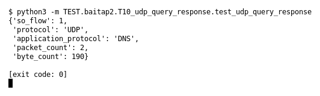

# T10 — UDP query/response (Bài 2)

Chạy (từ thư mục gốc repo): `python3 -m TEST.baitap2.T10_udp_query_response.test_udp_query_response`

## Test gì

Test case **T10 UDP query/response** ở mục 6 của đề.
Input/Scenario của đề: *DNS UDP hai chiều*. Kết quả mong đợi của đề: *1 UDP flow, packet/byte count đúng*.

## Input và output mong đợi

Input nằm ngay trong file `test_udp_query_response.py` (event dựng sẵn). Output mong đợi:

| Field | Mong đợi |
|---|---|
| `so_flow` | `1` |
| `protocol` | `UDP` |
| `application_protocol` | `DNS` |
| `packet_count` | `2` |
| `byte_count` | `190` |

## Kết quả chạy

Ngày chạy: 2026-10-13.

| Field | Output thật | Khớp |
|---|---|---|
| `so_flow` | `1` | ✓ |
| `protocol` | `UDP` | ✓ |
| `application_protocol` | `DNS` | ✓ |
| `packet_count` | `2` | ✓ |
| `byte_count` | `190` | ✓ |

**Kết luận:** 5/5 field đúng mong đợi, exit code 0 → **ĐẠT**.
