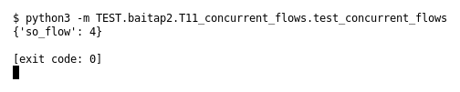

# T11 — Concurrent flows (Bài 2)

Chạy (từ thư mục gốc repo): `python3 -m TEST.baitap2.T11_concurrent_flows.test_concurrent_flows`

## Test gì

Test case **T11 Concurrent flows** ở mục 6 của đề.
Input/Scenario của đề: *≥2 flow có endpoint/port khác nhau*. Kết quả mong đợi của đề: *không gộp nhầm flow*.

## Input và output mong đợi

Input nằm ngay trong file `test_concurrent_flows.py` (event dựng sẵn). Output mong đợi:

| Field | Mong đợi |
|---|---|
| `so_flow` | `4` |

## Kết quả chạy

Ngày chạy: 2026-10-13.

| Field | Output thật | Khớp |
|---|---|---|
| `so_flow` | `4` | ✓ |

**Kết luận:** 1/1 field đúng mong đợi, exit code 0 → **ĐẠT**.
