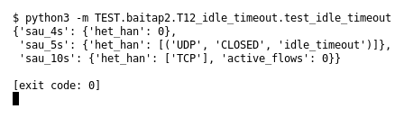

# T12 — Idle timeout (Bài 2)

Chạy (từ thư mục gốc repo): `python3 -m TEST.baitap2.T12_idle_timeout.test_idle_timeout`

## Test gì

Test case **T12 Idle timeout** ở mục 6 của đề.
Input/Scenario của đề: *flow không có packet mới quá timeout*. Kết quả mong đợi của đề: *flow hết hạn và bị loại khỏi active table*.

## Input và output mong đợi

Input nằm ngay trong file `test_idle_timeout.py` (event dựng sẵn). Output mong đợi:

| Field | Mong đợi |
|---|---|
| `sau_4s.het_han` | `0` |
| `sau_5s.het_han` | `[('UDP', 'CLOSED', 'idle_timeout')]` |
| `sau_10s.het_han` | `['TCP']` |
| `sau_10s.active_flows` | `0` |

## Kết quả chạy

Ngày chạy: 2026-10-13.

| Field | Output thật | Khớp |
|---|---|---|
| `sau_4s.het_han` | `0` | ✓ |
| `sau_5s.het_han` | `[('UDP', 'CLOSED', 'idle_timeout')]` | ✓ |
| `sau_10s.het_han` | `['TCP']` | ✓ |
| `sau_10s.active_flows` | `0` | ✓ |

**Kết luận:** 4/4 field đúng mong đợi, exit code 0 → **ĐẠT**.
