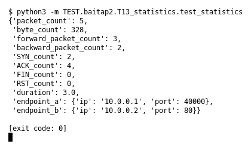

# T13 — Statistics (Bài 2)

Chạy (từ thư mục gốc repo): `python3 -m TEST.baitap2.T13_statistics.test_statistics`

## Test gì

Test case **T13 Statistics** ở mục 6 của đề.
Input/Scenario của đề: *nhiều packet hai chiều*. Kết quả mong đợi của đề: *packet/byte/flag counters và duration đúng*.

## Input và output mong đợi

Input nằm ngay trong file `test_statistics.py` (event dựng sẵn). Output mong đợi:

| Field | Mong đợi |
|---|---|
| `packet_count` | `5` |
| `byte_count` | `328` |
| `forward_packet_count` | `3` |
| `backward_packet_count` | `2` |
| `SYN_count` | `2` |
| `ACK_count` | `4` |
| `FIN_count` | `0` |
| `RST_count` | `0` |
| `duration` | `3` |
| `endpoint_a` | `{'ip': '10.0.0.1', 'port': 40000}` |
| `endpoint_b` | `{'ip': '10.0.0.2', 'port': 80}` |

## Kết quả chạy

Ngày chạy: 2026-10-13.

| Field | Output thật | Khớp |
|---|---|---|
| `packet_count` | `5` | ✓ |
| `byte_count` | `328` | ✓ |
| `forward_packet_count` | `3` | ✓ |
| `backward_packet_count` | `2` | ✓ |
| `SYN_count` | `2` | ✓ |
| `ACK_count` | `4` | ✓ |
| `FIN_count` | `0` | ✓ |
| `RST_count` | `0` | ✓ |
| `duration` | `3.0` | ✓ |
| `endpoint_a` | `{'ip': '10.0.0.1', 'port': 40000}` | ✓ |
| `endpoint_b` | `{'ip': '10.0.0.2', 'port': 80}` | ✓ |

**Kết luận:** 11/11 field đúng mong đợi, exit code 0 → **ĐẠT**.
