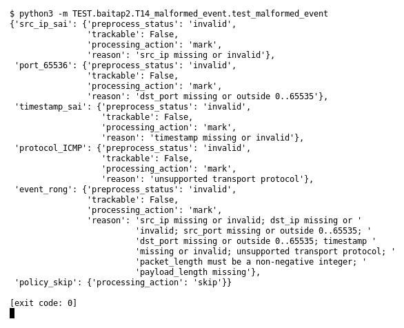

# T14 — Malformed event (Bài 2)

Chạy (từ thư mục gốc repo): `python3 -m TEST.baitap2.T14_malformed_event.test_malformed_event`

## Test gì

Test case **T14 Malformed event** ở mục 6 của đề.
Input/Scenario của đề: *event invalid/unsupported*. Kết quả mong đợi của đề: *không crash; status/reason phù hợp*.

## Input và output mong đợi

Input nằm ngay trong file `test_malformed_event.py` (event dựng sẵn). Output mong đợi:

| Field | Mong đợi |
|---|---|
| `src_ip_sai.preprocess_status` | `invalid` |
| `port_65536.preprocess_status` | `invalid` |
| `timestamp_sai.preprocess_status` | `invalid` |
| `protocol_ICMP.preprocess_status` | `invalid` |
| `event_rong.preprocess_status` | `invalid` |
| `src_ip_sai.trackable` | `False` |
| `port_65536.trackable` | `False` |
| `timestamp_sai.trackable` | `False` |
| `protocol_ICMP.trackable` | `False` |
| `event_rong.trackable` | `False` |
| `src_ip_sai.reason` | có `reason` (không rỗng) |
| `port_65536.reason` | có `reason` (không rỗng) |
| `timestamp_sai.reason` | có `reason` (không rỗng) |
| `protocol_ICMP.reason` | có `reason` (không rỗng) |
| `event_rong.reason` | có `reason` (không rỗng) |
| `policy_skip.processing_action` | `skip` |

## Kết quả chạy

Ngày chạy: 2026-10-13.

| Field | Output thật | Khớp |
|---|---|---|
| `src_ip_sai.preprocess_status` | `invalid` | ✓ |
| `port_65536.preprocess_status` | `invalid` | ✓ |
| `timestamp_sai.preprocess_status` | `invalid` | ✓ |
| `protocol_ICMP.preprocess_status` | `invalid` | ✓ |
| `event_rong.preprocess_status` | `invalid` | ✓ |
| `src_ip_sai.trackable` | `False` | ✓ |
| `port_65536.trackable` | `False` | ✓ |
| `timestamp_sai.trackable` | `False` | ✓ |
| `protocol_ICMP.trackable` | `False` | ✓ |
| `event_rong.trackable` | `False` | ✓ |
| `src_ip_sai.reason` | `src_ip missing or invalid` | ✓ |
| `port_65536.reason` | `dst_port missing or outside 0..65535` | ✓ |
| `timestamp_sai.reason` | `timestamp missing or invalid` | ✓ |
| `protocol_ICMP.reason` | `unsupported transport protocol` | ✓ |
| `event_rong.reason` | `src_ip missing or invalid; dst_ip missing or invalid; src_port missing or outside 0..65535; dst_port missing or outside 0..65535; timestamp missing or invalid; unsupported transport protocol; packet_length must be a non-negative integer; payload_length missing` | ✓ |
| `policy_skip.processing_action` | `skip` | ✓ |

**Kết luận:** 16/16 field đúng mong đợi, exit code 0 → **ĐẠT**.
