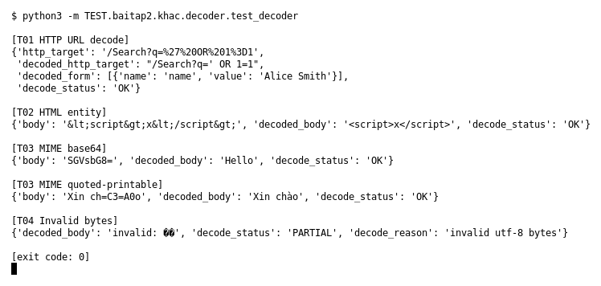

# Decoder (Bài 2)

Chạy (từ thư mục gốc repo): `python3 -m TEST.baitap2.khac.decoder.test_decoder`

## Test gì

Mục 3 của đề: `decode_event()` giải mã URL/form, HTML entity, MIME (Base64, Quoted-Printable)
và không crash khi gặp byte không hợp lệ. Gồm 4 case T01–T04 của đề.

## Input và output mong đợi

| Case | Input | Output mong đợi (theo đề) |
|---|---|---|
| T01 HTTP URL decode | `/Search?q=%27%20OR%201%3D1`, form `Alice+Smith` | `decoded_http_target` = `/Search?q=' OR 1=1`; URI gốc còn nguyên; form thành `Alice Smith` |
| T02 HTML entity | `&lt;script&gt;x&lt;/script&gt;` | `decoded_body` = ``; không crash |
| T03 MIME Base64 / QP | `SGVsbG8=` và `Xin ch=C3=A0o` | `Hello` và `Xin chào`, `decode_status` = OK |
| T04 Invalid bytes | payload có byte `0xff 0xfe` | `decode_status` = PARTIAL, có lý do, chương trình tiếp tục |

## Kết quả chạy

Ngày chạy: 2026-10-13.

| Case | Output thật | Khớp |
|---|---|---|
| T01 | `decoded_http_target` = `/Search?q=' OR 1=1`; `http_target` gốc vẫn là `%27%20OR…`; form `Alice Smith`; status OK | ✓ |
| T02 | `decoded_body` = ``; `body` gốc còn nguyên; OK | ✓ |
| T03 Base64 | `Hello`, OK | ✓ |
| T03 Quoted-Printable | `Xin chào`, OK | ✓ |
| T04 | `PARTIAL`, `decode_reason` = `invalid utf-8 bytes`, không crash | ✓ |

**Kết luận:** 5/5 output đúng mong đợi (4 case T01–T04) → **ĐẠT**.
