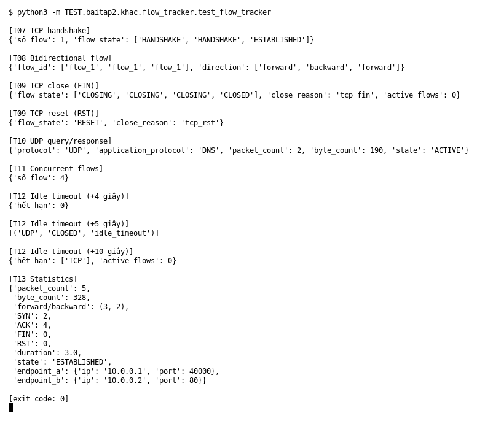

# Flow tracker (Bài 2)

Chạy (từ thư mục gốc repo): `python3 -m TEST.baitap2.khac.flow_tracker.test_flow_tracker`

## Test gì

Mục 5 của đề: gom packet thành flow hai chiều, theo dõi trạng thái TCP, UDP, idle timeout
và thống kê. Gồm 7 case T07–T13 của đề. Event đầu vào dựng bằng `sample_event()` (`TEST/baitap2/test_helpers.py`)
với timestamp cố định.

## Input và output mong đợi

| Case | Input | Output mong đợi (theo đề) |
|---|---|---|
| T07 TCP handshake | SYN → SYN/ACK → ACK | 1 flow, kết thúc ở `ESTABLISHED` |
| T08 Bidirectional | A→B, B→A, A→B | cùng `flow_id`, đúng direction |
| T09 TCP close | FIN/ACK hai phía; RST | `CLOSING` rồi `CLOSED`; `RESET` |
| T10 UDP query/response | DNS UDP 70 byte + 120 byte | 1 flow UDP/DNS, 2 packet, 190 byte |
| T11 Concurrent flows | 4 event khác endpoint/port/protocol | 4 flow riêng |
| T12 Idle timeout | TCP timeout 10s, UDP timeout 5s | UDP hết hạn ở +5s, TCP ở +10s, bị xóa khỏi active table |
| T13 Statistics | 5 packet hai chiều | packet/byte/flag count, duration, endpoint đúng |

## Kết quả chạy

Ngày chạy: 2026-10-13.

| Case | Output thật | Khớp |
|---|---|---|
| T07 | 1 flow; `HANDSHAKE, HANDSHAKE, ESTABLISHED` | ✓ |
| T08 | `flow_1` cả 3 lần; `forward, backward, forward` | ✓ |
| T09 FIN | `CLOSING, CLOSING, CLOSING, CLOSED`, `tcp_fin`, active table rỗng | ✓ |
| T09 RST | `RESET`, `tcp_rst` | ✓ |
| T10 | UDP/DNS, `packet_count` 2, `byte_count` 190 | ✓ |
| T11 | 4 flow | ✓ |
| T12 | +4s: 0 flow hết hạn; +5s: UDP `idle_timeout`; +10s: TCP hết hạn, active rỗng | ✓ |
| T13 | 5 packet, 328 byte, forward 3 / backward 2, SYN 2, ACK 4, duration 3, endpoint `10.0.0.1:40000` ↔ `10.0.0.2:80` | ✓ |

**Kết luận:** 8/8 output đúng mong đợi (7 case T07–T13) → **ĐẠT**.
