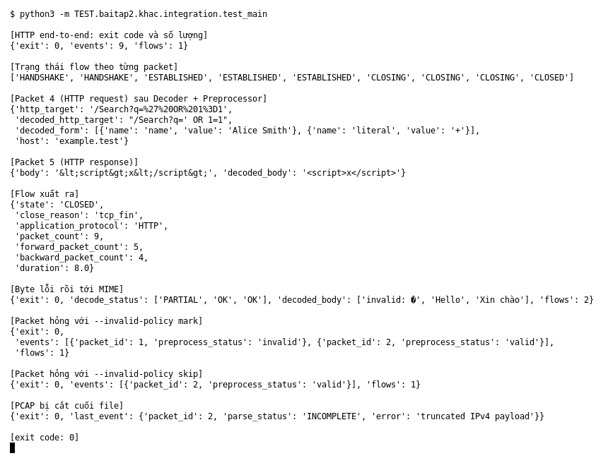

# Integration (Bài 2)

Chạy (từ thư mục gốc repo): `python3 -m TEST.baitap2.khac.integration.test_main`

## Test gì

Chạy `main.py` ở root như chương trình thật (qua `subprocess`) với PCAP do test tự dựng,
rồi đọc `events.jsonl` và `flows.jsonl` để xem cả chuỗi Parser → Decoder → Preprocessor → Flow Tracker
có cho ra output đúng không.

## Input và output mong đợi

| Case | Input | Output mong đợi |
|---|---|---|
| HTTP end-to-end | 9 packet: handshake, POST có form, response HTML, FIN | 9 event, 1 flow; state `… ESTABLISHED … CLOSING … CLOSED`; request đã decode; response ``; flow `CLOSED`, `tcp_fin`, 9 packet (5/4), duration 8 |
| Byte lỗi rồi MIME | 1 packet có byte `0xff`, 2 packet MIME (Base64, QP) | `PARTIAL`, `OK`, `OK`; body `Hello`, `Xin chào`; 2 flow |
| Packet hỏng, `--invalid-policy` | 1 packet IPv4 header hỏng + 1 packet tốt | `mark`: 2 event, packet 1 `invalid`; `skip`: chỉ còn packet 2 |
| PCAP bị cắt | cắt 10 byte cuối | exit 0, event cuối `INCOMPLETE` báo `truncated` |

## Kết quả chạy

Ngày chạy: 2026-10-13.

| Case | Output thật | Khớp |
|---|---|---|
| HTTP end-to-end | exit 0, 9 event, 1 flow; state đúng chuỗi mong đợi; `decoded_http_target` = `/Search?q=' OR 1=1`, form `Alice Smith`, host `example.test`; `decoded_body` = ``; flow `CLOSED`, `tcp_fin`, HTTP, 9 packet (5/4), duration 8 | ✓ |
| Byte lỗi rồi MIME | `PARTIAL, OK, OK`; `Hello`, `Xin chào`; 2 flow | ✓ |
| `mark` | 2 event: id 1 `invalid`, id 2 `valid` | ✓ |
| `skip` | 1 event: id 2 `valid` | ✓ |
| PCAP bị cắt | exit 0; packet 2 `INCOMPLETE`, `truncated IPv4 payload` | ✓ |

**Kết luận:** 5/5 output đúng mong đợi → **ĐẠT**.
`input/pcap/` và `output/evidence/` là PCAP và JSONL lưu sẵn do `make_evidence.py` sinh ra.
