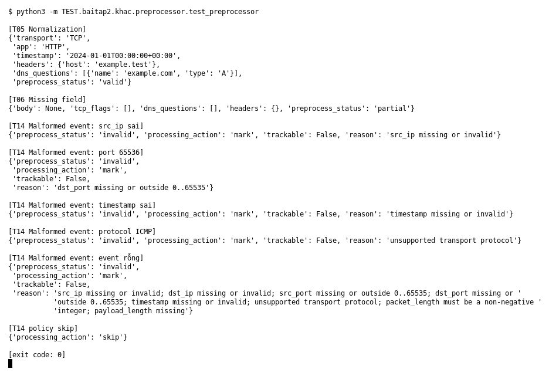

# Preprocessor (Bài 2)

Chạy (từ thư mục gốc repo): `python3 -m TEST.baitap2.khac.preprocessor.test_preprocessor`

## Test gì

Mục 4 của đề: `preprocess_event()` kiểm tra và chuẩn hóa event, xử lý field thiếu,
đánh dấu event sai. Gồm 3 case T05, T06, T14 của đề.

## Input và output mong đợi

| Case | Input | Output mong đợi (theo đề) |
|---|---|---|
| T05 Normalization | protocol `" tcp "`, `" http "`, header `" HOST "`, domain `" EXAMPLE.COM. "`, timestamp `+07:00` | `TCP`, `HTTP`, header `host: example.test`, domain `example.com`, timestamp UTC, status `valid` |
| T06 Missing field | event chỉ có các field bắt buộc | không exception; `body = None`, `tcp_flags = []`, `headers = {}`, status `partial` |
| T14 Malformed event | IP sai, port 65536, timestamp sai, protocol ICMP, event rỗng | `invalid`, `trackable = False`, có `reason`; policy `skip` cho `processing_action = skip` |

## Kết quả chạy

Ngày chạy: 2026-10-13.

| Case | Output thật | Khớp |
|---|---|---|
| T05 | `TCP`, `HTTP`, `2024-01-01T00:00:00+00:00`, `{host: example.test}`, `example.com`, `valid` | ✓ |
| T06 | `body None`, `tcp_flags []`, `headers {}`, `partial` | ✓ |
| T14 src_ip sai | `invalid`, `src_ip missing or invalid` | ✓ |
| T14 port 65536 | `invalid`, `dst_port … outside 0..65535` | ✓ |
| T14 timestamp sai | `invalid`, `timestamp missing or invalid` | ✓ |
| T14 protocol ICMP | `invalid`, `unsupported transport protocol` | ✓ |
| T14 event rỗng | `invalid`, liệt kê đủ các field thiếu | ✓ |
| T14 policy skip | `processing_action = skip` | ✓ |

**Kết luận:** 8/8 output đúng mong đợi (3 case T05, T06, T14) → **ĐẠT**.
