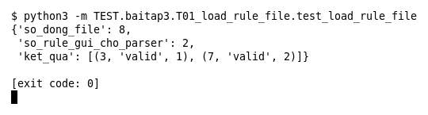

# T01 — Nạp file rule (Bài 3)

Chạy (từ thư mục gốc repo): `python3 -m TEST.baitap3.T01_load_rule_file.test_load_rule_file`

## Test gì

Test case **T01 Nạp file có rule hợp lệ, comment và dòng trống** ở mục 7 của đề. Kết quả mong đợi của đề: *Chỉ rule hợp lệ được đưa sang parser.*

Test nạp một file `.rules` gồm 8 dòng: 2 rule hợp lệ, 3 dòng comment, 3 dòng trống (một dòng chỉ có khoảng trắng).

## Input và output mong đợi

Input là file rule `input/load_rule_file.rules` (event dựng sẵn trong file test):

```
# Rule mẫu cho test T01: 2 rule hợp lệ, xen kẽ comment và dòng trống.

alert tcp any any -> any 80 (msg:"Web request"; content:"GET"; sid:1; rev:1;)

# comment giữa file
   
alert udp any any -> any 53 (msg:"DNS query"; sid:2; rev:1;)
# comment cuối file
```

Output mong đợi:

| Hạng mục | Mong đợi |
|---|---|
| so_rule_gui_cho_parser | `2` |
| ket_qua | `[(3, 'valid', 1), (7, 'valid', 2)]` |
| so_dong_file | `8` |

## Kết quả chạy



Ngày chạy: 2026-10-25.

| Hạng mục | Output thật | Khớp |
|---|---|---|
| so_rule_gui_cho_parser | `2` | ✓ |
| ket_qua | `[(3, 'valid', 1), (7, 'valid', 2)]` | ✓ |
| so_dong_file | `8` | ✓ |

**Kết luận:** 3/3 hạng mục đúng mong đợi, exit code 0 → **ĐẠT**.
