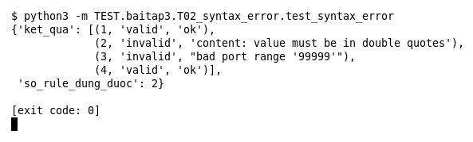

# T02 — Rule sai cú pháp (Bài 3)

Chạy (từ thư mục gốc repo): `python3 -m TEST.baitap3.T02_syntax_error.test_syntax_error`

## Test gì

Test case **T02 Rule sai cú pháp** ở mục 7 của đề. Kết quả mong đợi của đề: *Đánh dấu invalid, có lý do; engine tiếp tục chạy.*

Test 4 rule: rule 2 thiếu dấu `;` sau `content`, rule 3 có port 99999. Rule 1 và 4 đúng, nằm trước/sau rule lỗi.

## Input và output mong đợi

Input là file rule `input/syntax_error.rules` (event dựng sẵn trong file test):

```
alert tcp any any -> any 80 (msg:"Rule truoc"; sid:1; rev:1;)
alert tcp any any -> any 80 (msg:"Thieu dau cham phay"; content:"abc" sid:2; rev:1;)
alert tcp any any -> any 99999 (msg:"Port sai"; sid:3; rev:1;)
alert tcp any any -> any 80 (msg:"Rule sau"; sid:4; rev:1;)
```

Output mong đợi:

| Hạng mục | Mong đợi |
|---|---|
| status từng dòng | `['valid', 'invalid', 'invalid', 'valid']` |
| dòng lỗi có lý do | `[True, True]` |
| so_rule_dung_duoc (engine vẫn nạp rule 1 và 4) | `2` |

## Kết quả chạy



Ngày chạy: 2026-10-25.

| Hạng mục | Output thật | Khớp |
|---|---|---|
| status từng dòng | `['valid', 'invalid', 'invalid', 'valid']` | ✓ |
| dòng lỗi có lý do | `[True, True]` | ✓ |
| so_rule_dung_duoc (engine vẫn nạp rule 1 và 4) | `2` | ✓ |

**Kết luận:** 3/3 hạng mục đúng mong đợi, exit code 0 → **ĐẠT**.
