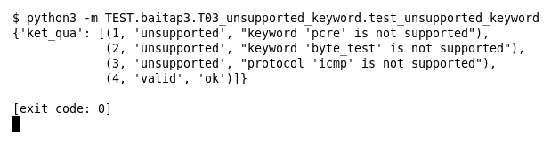

# T03 — Keyword ngoài phạm vi (Bài 3)

Chạy (từ thư mục gốc repo): `python3 -m TEST.baitap3.T03_unsupported_keyword.test_unsupported_keyword`

## Test gì

Test case **T03 Rule dùng keyword ngoài phạm vi** ở mục 7 của đề. Kết quả mong đợi của đề: *Đánh dấu unsupported; không crash.*

Test 4 rule: `pcre`, `byte_test`, protocol `icmp` (cả ba ngoài phạm vi) và một rule hợp lệ ở cuối.

## Input và output mong đợi

Input là file rule `input/unsupported_keyword.rules` (event dựng sẵn trong file test):

```
alert tcp any any -> any 80 (msg:"Dung pcre"; pcre:"/abc/"; sid:1; rev:1;)
alert tcp any any -> any 80 (msg:"Dung byte_test"; content:"x"; byte_test:2,>,10,0; sid:2; rev:1;)
alert icmp any any -> any any (msg:"Giao thuc icmp"; sid:3; rev:1;)
alert tcp any any -> any 80 (msg:"Rule duoc ho tro"; content:"GET"; sid:4; rev:1;)
```

Output mong đợi:

| Hạng mục | Mong đợi |
|---|---|
| status từng dòng | `['unsupported', 'unsupported', 'unsupported', 'valid']` |
| lý do nêu đúng keyword | `['pcre', 'byte_test', 'icmp']` |

## Kết quả chạy



Ngày chạy: 2026-10-25.

| Hạng mục | Output thật | Khớp |
|---|---|---|
| status từng dòng | `['unsupported', 'unsupported', 'unsupported', 'valid']` | ✓ |
| lý do nêu đúng keyword | `['pcre', 'byte_test', 'icmp']` | ✓ |

**Kết luận:** 2/2 hạng mục đúng mong đợi, exit code 0 → **ĐẠT**.
