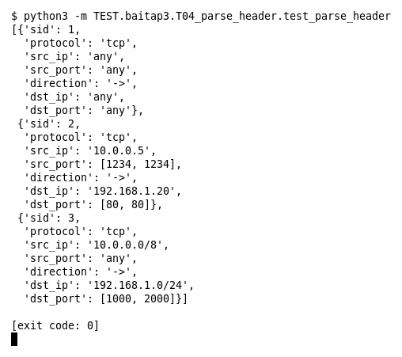

# T04 — Parse header (Bài 3)

Chạy (từ thư mục gốc repo): `python3 -m TEST.baitap3.T04_parse_header.test_parse_header`

## Test gì

Test case **T04 Parse header TCP + any/single IP/CIDR + port/range** ở mục 7 của đề. Kết quả mong đợi của đề: *Internal Rule Object đúng.*

Test 3 rule: `any any`, IP đơn + port đơn, CIDR + port range. Test in các field header của Internal Rule Object.

## Input và output mong đợi

Input là file rule `input/parse_header.rules` (event dựng sẵn trong file test):

```
alert tcp any any -> any any (msg:"any"; sid:1; rev:1;)
alert tcp 10.0.0.5 1234 -> 192.168.1.20 80 (msg:"single ip, single port"; sid:2; rev:1;)
alert tcp 10.0.0.0/8 any -> 192.168.1.0/24 1000:2000 (msg:"cidr, port range"; sid:3; rev:1;)
```

Output mong đợi:

| Hạng mục | Mong đợi |
|---|---|
| sid 1: any/any | `('any', 'any', 'any', 'any')` |
| sid 2: IP đơn, port đơn | `('10.0.0.5', [1234, 1234], '192.168.1.20', [80, 80])` |
| sid 3: CIDR, port range | `('10.0.0.0/8', 'any', '192.168.1.0/24', [1000, 2000])` |
| protocol cả 3 rule | `['tcp', 'tcp', 'tcp']` |

## Kết quả chạy



Ngày chạy: 2026-10-25.

| Hạng mục | Output thật | Khớp |
|---|---|---|
| sid 1: any/any | `('any', 'any', 'any', 'any')` | ✓ |
| sid 2: IP đơn, port đơn | `('10.0.0.5', [1234, 1234], '192.168.1.20', [80, 80])` | ✓ |
| sid 3: CIDR, port range | `('10.0.0.0/8', 'any', '192.168.1.0/24', [1000, 2000])` | ✓ |
| protocol cả 3 rule | `['tcp', 'tcp', 'tcp']` | ✓ |

**Kết luận:** 4/4 hạng mục đúng mong đợi, exit code 0 → **ĐẠT**.
