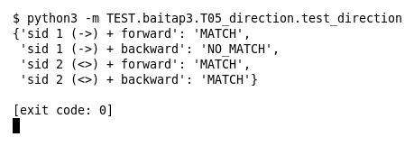

# T05 — Direction (Bài 3)

Chạy (từ thư mục gốc repo): `python3 -m TEST.baitap3.T05_direction.test_direction`

## Test gì

Test case **T05 Direction `->` và `<>`** ở mục 7 của đề. Kết quả mong đợi của đề: *So khớp đúng chiều/bidirectional.*

Rule 1 dùng `->`, rule 2 dùng `<>`, cùng header `10.0.0.5 -> 192.168.1.20:80`. Event `forward` đi cùng chiều rule, event `backward` là chiều ngược lại.

## Input và output mong đợi

Input là file rule `input/direction.rules` (event dựng sẵn trong file test):

```
alert tcp 10.0.0.5 any -> 192.168.1.20 80 (msg:"mot chieu"; sid:1; rev:1;)
alert tcp 10.0.0.5 any <> 192.168.1.20 80 (msg:"hai chieu"; sid:2; rev:1;)
```

Output mong đợi:

| Hạng mục | Mong đợi |
|---|---|
| sid 1 (->) + forward | `'MATCH'` |
| sid 1 (->) + backward | `'NO_MATCH'` |
| sid 2 (<>) + forward | `'MATCH'` |
| sid 2 (<>) + backward | `'MATCH'` |

## Kết quả chạy



Ngày chạy: 2026-10-25.

| Hạng mục | Output thật | Khớp |
|---|---|---|
| sid 1 (->) + forward | `'MATCH'` | ✓ |
| sid 1 (->) + backward | `'NO_MATCH'` | ✓ |
| sid 2 (<>) + forward | `'MATCH'` | ✓ |
| sid 2 (<>) + backward | `'MATCH'` | ✓ |

**Kết luận:** 4/4 hạng mục đúng mong đợi, exit code 0 → **ĐẠT**.
