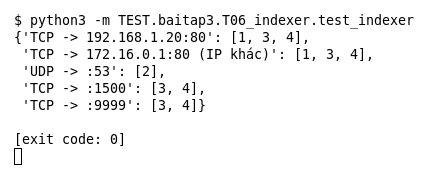

# T06 — Indexer (Bài 3)

Chạy (từ thư mục gốc repo): `python3 -m TEST.baitap3.T06_indexer.test_indexer`

## Test gì

Test case **T06 Indexer với IP, TCP, UDP và any** ở mục 7 của đề. Kết quả mong đợi của đề: *Trả đúng tập candidate rules.*

4 rule: (1) TCP IP cụ thể port 80, (2) UDP port 53, (3) TCP `any any`, (4) TCP CIDR port range 1000:2000. Indexer chia theo protocol rồi theo dst port; IP được kiểm tra ở bước matching, nên rule có port range/any luôn là candidate của protocol đó.

## Input và output mong đợi

Input là file rule `input/indexer.rules` (event dựng sẵn trong file test):

```
alert tcp 10.0.0.5 any -> 192.168.1.20 80 (msg:"1 tcp ip cu the port 80"; sid:1; rev:1;)
alert udp any any -> any 53 (msg:"2 udp port 53"; sid:2; rev:1;)
alert tcp any any -> any any (msg:"3 tcp any any"; sid:3; rev:1;)
alert tcp 10.0.0.0/8 any -> any 1000:2000 (msg:"4 tcp cidr port range"; sid:4; rev:1;)
```

Output mong đợi:

| Hạng mục | Mong đợi |
|---|---|
| TCP -> :80 | `[1, 3, 4]` |
| TCP -> :80, IP khác | `[1, 3, 4]` |
| UDP -> :53 | `[2]` |
| TCP -> :1500 | `[3, 4]` |
| TCP -> :9999 | `[3, 4]` |

## Kết quả chạy



Ngày chạy: 2026-10-25.

| Hạng mục | Output thật | Khớp |
|---|---|---|
| TCP -> :80 | `[1, 3, 4]` | ✓ |
| TCP -> :80, IP khác | `[1, 3, 4]` | ✓ |
| UDP -> :53 | `[2]` | ✓ |
| TCP -> :1500 | `[3, 4]` | ✓ |
| TCP -> :9999 | `[3, 4]` | ✓ |

**Kết luận:** 5/5 hạng mục đúng mong đợi, exit code 0 → **ĐẠT**.
