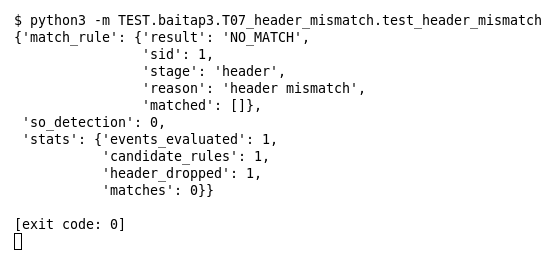

# T07 — Header không match (Bài 3)

Chạy (từ thư mục gốc repo): `python3 -m TEST.baitap3.T07_header_mismatch.test_header_mismatch`

## Test gì

Test case **T07 Header không match** ở mục 7 của đề. Kết quả mong đợi của đề: *Rule bị loại trước content matching.*

Rule chỉ nhận IP đích `192.168.1.20`; event có payload chứa `../` nhưng đi tới `172.16.0.9`. Nếu header bị loại trước thì `stage` là `header`, không có Detection Event.

## Input và output mong đợi

Input là file rule `input/header_mismatch.rules` (event dựng sẵn trong file test):

```
alert tcp any any -> 192.168.1.20 80 (msg:"Directory traversal"; content:"../"; sid:1; rev:1;)
```

Output mong đợi:

| Hạng mục | Mong đợi |
|---|---|
| result | `'NO_MATCH'` |
| stage (bước loại rule) | `'header'` |
| so_detection | `0` |
| stats.header_dropped | `1` |

## Kết quả chạy



Ngày chạy: 2026-10-25.

| Hạng mục | Output thật | Khớp |
|---|---|---|
| result | `'NO_MATCH'` | ✓ |
| stage (bước loại rule) | `'header'` | ✓ |
| so_detection | `0` | ✓ |
| stats.header_dropped | `1` | ✓ |

**Kết luận:** 4/4 hạng mục đúng mong đợi, exit code 0 → **ĐẠT**.
