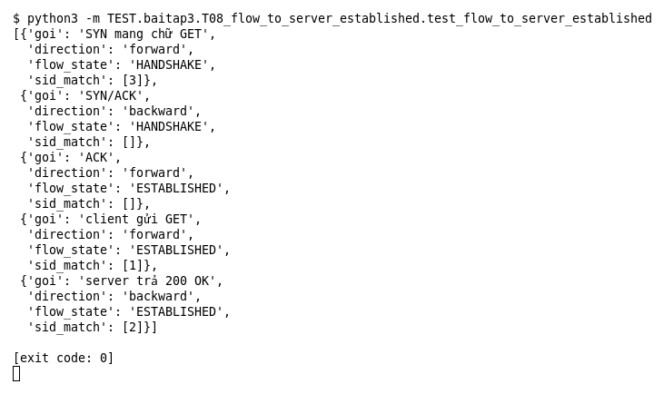

# T08 — flow:to_server,established (Bài 3)

Chạy (từ thư mục gốc repo): `python3 -m TEST.baitap3.T08_flow_to_server_established.test_flow_to_server_established`

## Test gì

Test case **T08 flow:to_server,established** ở mục 7 của đề. Kết quả mong đợi của đề: *Match đúng theo Flow Tracker.*

3 rule: (1) `to_server,established` + `GET`, (2) `to_client,established` + `200 OK`, (3) `to_server,not_established` + `GET`. 5 gói đi qua Flow Tracker thật rồi mới vào engine: SYN (mang chữ GET), SYN/ACK, ACK, client gửi GET, server trả 200 OK.

## Input và output mong đợi

Input là file rule `input/flow_to_server_established.rules` (event dựng sẵn trong file test):

```
alert tcp any any -> any any (msg:"1 to_server,established"; flow:to_server,established; content:"GET"; sid:1; rev:1;)
alert tcp any any -> any any (msg:"2 to_client,established"; flow:to_client,established; content:"200 OK"; sid:2; rev:1;)
alert tcp any any -> any any (msg:"3 to_server,not_established"; flow:to_server,not_established; content:"GET"; sid:3; rev:1;)
```

Output mong đợi:

| Hạng mục | Mong đợi |
|---|---|
| direction/flow_state từng gói | `[('forward', 'HANDSHAKE'), ('backward', 'HANDSHAKE'), ('forward', 'ESTABLISHED'), ('forward', 'ESTABLISHED'), ('backward', 'ESTABLISHED')]` |
| sid match từng gói | `[[3], [], [], [1], [2]]` |

## Kết quả chạy



Ngày chạy: 2026-10-25.

| Hạng mục | Output thật | Khớp |
|---|---|---|
| direction/flow_state từng gói | `[('forward', 'HANDSHAKE'), ('backward', 'HANDSHAKE'), ('forward', 'ESTABLISHED'), ('forward', 'ESTABLISHED'), ('backward', 'ESTABLISHED')]` | ✓ |
| sid match từng gói | `[[3], [], [], [1], [2]]` | ✓ |

**Kết luận:** 2/2 hạng mục đúng mong đợi, exit code 0 → **ĐẠT**.
