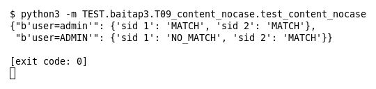

# T09 — content có/không có nocase (Bài 3)

Chạy (từ thư mục gốc repo): `python3 -m TEST.baitap3.T09_content_nocase.test_content_nocase`

## Test gì

Test case **T09 content có/không có nocase** ở mục 7 của đề. Kết quả mong đợi của đề: *Phân biệt/không phân biệt hoa thường đúng.*

Rule 1 `content:"admin"` (phân biệt hoa thường), rule 2 thêm `nocase`. Hai payload: `user=admin` và `user=ADMIN`.

## Input và output mong đợi

Input là file rule `input/content_nocase.rules` (event dựng sẵn trong file test):

```
alert tcp any any -> any 80 (msg:"1 khong nocase"; content:"admin"; sid:1; rev:1;)
alert tcp any any -> any 80 (msg:"2 co nocase"; content:"admin"; nocase; sid:2; rev:1;)
```

Output mong đợi:

| Hạng mục | Mong đợi |
|---|---|
| user=admin: sid 1 / sid 2 | `('MATCH', 'MATCH')` |
| user=ADMIN: sid 1 / sid 2 | `('NO_MATCH', 'MATCH')` |

## Kết quả chạy



Ngày chạy: 2026-10-25.

| Hạng mục | Output thật | Khớp |
|---|---|---|
| user=admin: sid 1 / sid 2 | `('MATCH', 'MATCH')` | ✓ |
| user=ADMIN: sid 1 / sid 2 | `('NO_MATCH', 'MATCH')` | ✓ |

**Kết luận:** 2/2 hạng mục đúng mong đợi, exit code 0 → **ĐẠT**.
