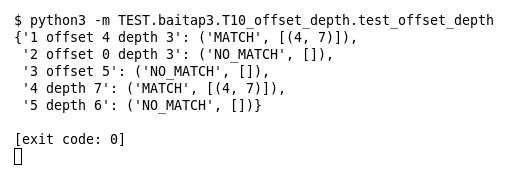

# T10 — offset/depth (Bài 3)

Chạy (từ thư mục gốc repo): `python3 -m TEST.baitap3.T10_offset_depth.test_offset_depth`

## Test gì

Test case **T10 offset/depth** ở mục 7 của đề. Kết quả mong đợi của đề: *Chỉ match trong vùng được chỉ định.*

Payload `AAAAGETBBBB`, chữ `GET` nằm ở byte 4..7. 5 rule dùng offset/depth khác nhau.

## Input và output mong đợi

Input là file rule `input/offset_depth.rules` (event dựng sẵn trong file test):

```
alert tcp any any -> any 80 (msg:"1 offset 4 depth 3"; content:"GET"; offset:4; depth:3; sid:1; rev:1;)
alert tcp any any -> any 80 (msg:"2 offset 0 depth 3"; content:"GET"; offset:0; depth:3; sid:2; rev:1;)
alert tcp any any -> any 80 (msg:"3 offset 5"; content:"GET"; offset:5; sid:3; rev:1;)
alert tcp any any -> any 80 (msg:"4 depth 7"; content:"GET"; depth:7; sid:4; rev:1;)
alert tcp any any -> any 80 (msg:"5 depth 6"; content:"GET"; depth:6; sid:5; rev:1;)
```

Output mong đợi:

| Hạng mục | Mong đợi |
|---|---|
| 1 offset 4 depth 3 | `('MATCH', [(4, 7)])` |
| 2 offset 0 depth 3 (vùng 0..3) | `('NO_MATCH', [])` |
| 3 offset 5 (vùng 5..hết) | `('NO_MATCH', [])` |
| 4 depth 7 (vùng 0..7) | `('MATCH', [(4, 7)])` |
| 5 depth 6 (vùng 0..6) | `('NO_MATCH', [])` |

## Kết quả chạy



Ngày chạy: 2026-10-25.

| Hạng mục | Output thật | Khớp |
|---|---|---|
| 1 offset 4 depth 3 | `('MATCH', [(4, 7)])` | ✓ |
| 2 offset 0 depth 3 (vùng 0..3) | `('NO_MATCH', [])` | ✓ |
| 3 offset 5 (vùng 5..hết) | `('NO_MATCH', [])` | ✓ |
| 4 depth 7 (vùng 0..7) | `('MATCH', [(4, 7)])` | ✓ |
| 5 depth 6 (vùng 0..6) | `('NO_MATCH', [])` | ✓ |

**Kết luận:** 5/5 hạng mục đúng mong đợi, exit code 0 → **ĐẠT**.
