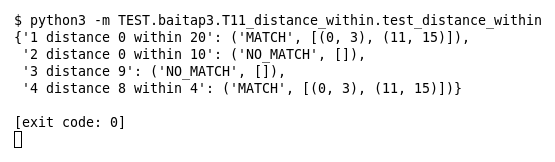

# T11 — Hai content với distance/within (Bài 3)

Chạy (từ thư mục gốc repo): `python3 -m TEST.baitap3.T11_distance_within.test_distance_within`

## Test gì

Test case **T11 Hai content với distance/within** ở mục 7 của đề. Kết quả mong đợi của đề: *Relative matching đúng.*

Payload `GET /a.php HTTP/1.1`: `GET` kết thúc ở byte 3, `HTTP` nằm ở byte 11..15 (cách 8 byte). 4 rule tìm `GET` rồi `HTTP` với distance/within khác nhau.

## Input và output mong đợi

Input là file rule `input/distance_within.rules` (event dựng sẵn trong file test):

```
alert tcp any any -> any 80 (msg:"1 distance 0 within 20"; content:"GET"; content:"HTTP"; distance:0; within:20; sid:1; rev:1;)
alert tcp any any -> any 80 (msg:"2 distance 0 within 10"; content:"GET"; content:"HTTP"; distance:0; within:10; sid:2; rev:1;)
alert tcp any any -> any 80 (msg:"3 distance 9"; content:"GET"; content:"HTTP"; distance:9; sid:3; rev:1;)
alert tcp any any -> any 80 (msg:"4 distance 8 within 4"; content:"GET"; content:"HTTP"; distance:8; within:4; sid:4; rev:1;)
```

Output mong đợi:

| Hạng mục | Mong đợi |
|---|---|
| 1 distance 0 within 20 (vùng 3..23) | `('MATCH', [(0, 3), (11, 15)])` |
| 2 distance 0 within 10 (vùng 3..13) | `('NO_MATCH', [])` |
| 3 distance 9 (từ byte 12) | `('NO_MATCH', [])` |
| 4 distance 8 within 4 (vùng 11..15) | `('MATCH', [(0, 3), (11, 15)])` |

## Kết quả chạy



Ngày chạy: 2026-10-25.

| Hạng mục | Output thật | Khớp |
|---|---|---|
| 1 distance 0 within 20 (vùng 3..23) | `('MATCH', [(0, 3), (11, 15)])` | ✓ |
| 2 distance 0 within 10 (vùng 3..13) | `('NO_MATCH', [])` | ✓ |
| 3 distance 9 (từ byte 12) | `('NO_MATCH', [])` | ✓ |
| 4 distance 8 within 4 (vùng 11..15) | `('MATCH', [(0, 3), (11, 15)])` | ✓ |

**Kết luận:** 4/4 hạng mục đúng mong đợi, exit code 0 → **ĐẠT**.
