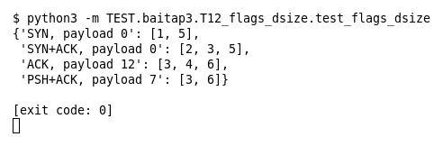

# T12 — flags và dsize (Bài 3)

Chạy (từ thư mục gốc repo): `python3 -m TEST.baitap3.T12_flags_dsize.test_flags_dsize`

## Test gì

Test case **T12 flags và dsize** ở mục 7 của đề. Kết quả mong đợi của đề: *Match/không match đúng theo event.*

6 rule: `flags:S`, `flags:SA`, `flags:A+` (có ACK, cờ khác tùy ý), `dsize:>10`, `dsize:0`, `dsize:5<>20`. 4 event có cờ và payload khác nhau.

## Input và output mong đợi

Input là file rule `input/flags_dsize.rules` (event dựng sẵn trong file test):

```
alert tcp any any -> any any (msg:"1 flags S"; flags:S; sid:1; rev:1;)
alert tcp any any -> any any (msg:"2 flags SA"; flags:SA; sid:2; rev:1;)
alert tcp any any -> any any (msg:"3 flags A+"; flags:A+; sid:3; rev:1;)
alert tcp any any -> any any (msg:"4 dsize >10"; dsize:>10; sid:4; rev:1;)
alert tcp any any -> any any (msg:"5 dsize 0"; dsize:0; sid:5; rev:1;)
alert tcp any any -> any any (msg:"6 dsize 5<>20"; dsize:5<>20; sid:6; rev:1;)
```

Output mong đợi:

| Hạng mục | Mong đợi |
|---|---|
| SYN, payload 0 | `[1, 5]` |
| SYN+ACK, payload 0 | `[2, 3, 5]` |
| ACK, payload 12 | `[3, 4, 6]` |
| PSH+ACK, payload 7 | `[3, 6]` |

## Kết quả chạy



Ngày chạy: 2026-10-25.

| Hạng mục | Output thật | Khớp |
|---|---|---|
| SYN, payload 0 | `[1, 5]` | ✓ |
| SYN+ACK, payload 0 | `[2, 3, 5]` | ✓ |
| ACK, payload 12 | `[3, 4, 6]` | ✓ |
| PSH+ACK, payload 7 | `[3, 6]` | ✓ |

**Kết luận:** 4/4 hạng mục đúng mong đợi, exit code 0 → **ĐẠT**.
