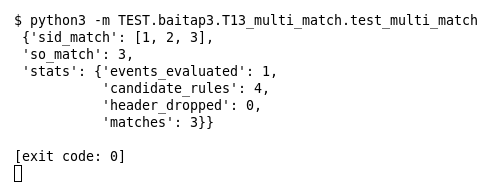

# T13 — Một event match ≥2 rule (Bài 3)

Chạy (từ thư mục gốc repo): `python3 -m TEST.baitap3.T13_multi_match.test_multi_match`

## Test gì

Test case **T13 Một event match đồng thời ≥2 rule** ở mục 7 của đề. Kết quả mong đợi của đề: *Sinh đầy đủ các kết quả match.*

4 rule trên cùng một event `GET /../etc/passwd HTTP/1.1` tới port 80: rule 1 (`GET`), 2 (`../`), 3 (chỉ header + `to_server`) khớp; rule 4 (`passwd-shadow`) không khớp.

## Input và output mong đợi

Input là file rule `input/multi_match.rules` (event dựng sẵn trong file test):

```
alert tcp any any -> any 80 (msg:"1 co GET"; content:"GET"; sid:1; rev:1;)
alert tcp any any -> any 80 (msg:"2 co ../"; content:"../"; sid:2; rev:1;)
alert tcp any any -> any any (msg:"3 chi header"; flow:to_server; sid:3; rev:1;)
alert tcp any any -> any 80 (msg:"4 khong khop"; content:"passwd-shadow"; sid:4; rev:1;)
```

Output mong đợi:

| Hạng mục | Mong đợi |
|---|---|
| sid_match (không dừng ở match đầu tiên) | `[1, 2, 3]` |
| so_match | `3` |
| stats.candidate_rules | `4` |
| stats.matches | `3` |

## Kết quả chạy



Ngày chạy: 2026-10-25.

| Hạng mục | Output thật | Khớp |
|---|---|---|
| sid_match (không dừng ở match đầu tiên) | `[1, 2, 3]` | ✓ |
| so_match | `3` | ✓ |
| stats.candidate_rules | `4` | ✓ |
| stats.matches | `3` | ✓ |

**Kết luận:** 4/4 hạng mục đúng mong đợi, exit code 0 → **ĐẠT**.
